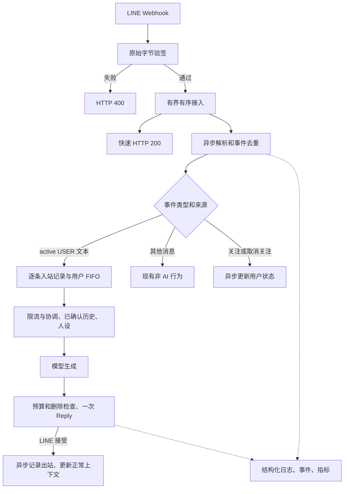
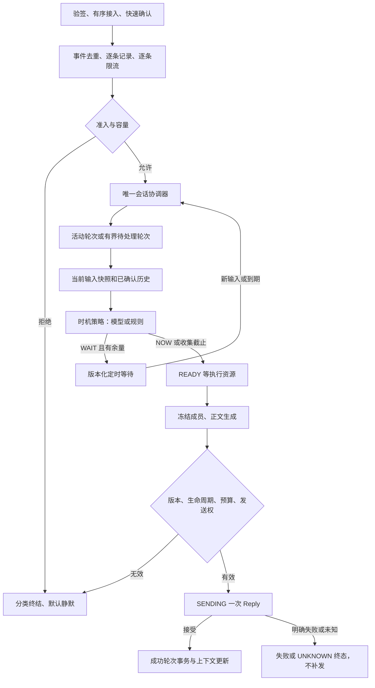
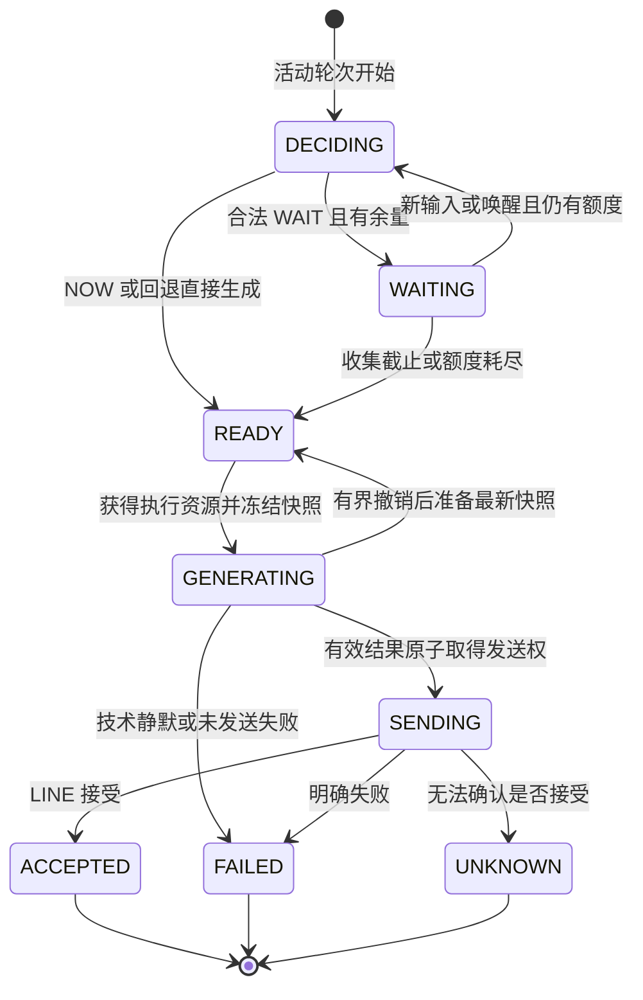

# 虚拟角色聊天项目：总流程骨架

> 本文用于理解全局流程、阶段职责和扩展边界，不替代接口契约或具体阶段任务。
> **当前已实现：P0/P1、P2 前三阶段规则聚合。P2 MODEL 时机判断、多成员权威历史和完整生命周期仍待后续阶段，P3～P8 未实现。** 已有内部 Push 不等于已有主动聊天调度。
> 当前接口、配置和运行方式统一见 [接口文档](接口文档.md)；P2 的参数、状态机、测试和实施步骤只在 [P2 任务文档](P2任务文档.md) 维护。
> 日期：2026-10-16（Asia/Shanghai）。下文流程图为架构示意，场景为虚构，不代表运行结果。

## 一、整体目标与分工

产品目标是形成连贯、有分寸、有稳定角色特征的长期对话。自然度来自内容、记忆、时机和状态一致性共同作用，不能用固定拖延或虚构现实经历替代。

贯穿各阶段的分工：**模型提出语义建议，程序控制执行权限，LINE 回执确认请求是否被接受，PostgreSQL 保存权威业务记录。** 四者不能互相冒充。

| 层次 | 负责的问题 | 不拥有的权限 |
| --- | --- | --- |
| 接入与准入 | 来源是否合法、是否重复、顺序与资源是否允许 | 不等待模型、不把 HTTP 200 解释为回复成功 |
| 会话协调 | 哪些输入属于同轮、何时唤醒、版本和截止是否有效 | 不让模型修改硬截止或绕过删除 |
| 策略与生成 | 是否适合接话、等待倾向、回复内容 | 不直接拿凭证发送，不决定无限重试 |
| 发送执行 | 当前是否可发、请求是否合法、结果如何分类 | 不把未知当失败后随意换通道补发 |
| 历史与记录 | 已接受完整轮次、原始消息、行为与审计 | 不用“无记录”推断“没发生” |

## 二、P0/P1 单条兼容流程（已实现基线）

上图是 AI_AGGREGATION_ENABLED=false 时的单条兼容主路径；生产默认已走第三节的规则轮次部分。异常按当前接口文档分类；技术提示默认静默。接收队列拒绝仍返回 200；异步写库失败不阻止 Reply，所以存在任务或记录丢失窗口。

P1 兼容模式中同用户后续消息会等待前一条任务，超过排队上限可能静默结束；当前取消关注仍只更新状态，带新旧判定的取消生成留待 P2 第七阶段。P1 的一轮是一条入站与一个已被 LINE 接受的正常 AI 回复。

第三阶段已有规则多成员聚合，不能据此推导出模型时机判断、持久化任务、跨重启发送幂等、多实例排序或主动联系；这些仍未实现。

## 三、P2 目标流程（前三阶段部分已实现）

第三阶段已接入逐条限流、唯一协调器、RULE 时机建议、完整多成员正文和一次发送结果收尾；图中的 MODEL 策略与成功多成员事务/上下文尚未实现。多成员过渡出站完整保留，但第五阶段关联表完成前不进入后续上下文；当前运行事实以接口文档 2.6 为准。

这个流程将“接话判断”与“可靠执行”分开。等待和排队都消耗原始接收预算，新消息可以改变内容和建议，不能重置已等待时间。

### 3.1 一个轮次的生命周期

为保持可读性，图中省略各未发送状态到 EXPIRED/CANCELLED/REJECTED 的公共出口；这些出口及具体条件以 P2 任务文档为准。SENDING 不能被当作未发送直接取消，必须按实际接受/失败/未知收尾。

### 3.2 新消息插入的四种情况

| 到达时机 | 处理 | 保持的不变量 |
| --- | --- | --- |
| DECIDING/WAITING | 合入允许收集的轮次，旧判断/唤醒失效 | 不逐消息并发判断，不延后收集/总截止 |
| READY 尚未冻结 | 容量及收集时间允许时合入 | 不重新计算完整排队时限 |
| GENERATING | 满足有界撤销条件则重生成，否则放下一轮 | 旧结果失效，共享时间与物理调用额度 |
| SENDING | 下一轮 | 当前发送不可撤销，不能抢用其 Token |

待处理轮次从自身首条接收起计时，等待前轮的耗时照计；到收集截止即冻结。前轮终结后直接检查剩余预算，不重新等待。持续连发不能无限拖住最早消息，也不能无界新建轮次。

## 四、数据、凭证与确认的骨架

### 4.1 数据生命周期

| 数据 | 所在位置与用途 | 何时有效 |
| --- | --- | --- |
| 原始允许业务消息 | 逐条异步写 PostgreSQL，运行日志可完整记录 | 不因合并改写；落库仍尽力 |
| 当前轮次、定时与调用状态 | 有界进程内存 | P2 不跨重启恢复 |
| Reply Token | 当前即时流程的隔离内存引用 | 只供本轮一次发送，不入模型、数据库、Redis、日志或恢复任务 |
| 策略建议/生成结果 | 绑定快照版本，按白名单记录业务信息 | 有效版本才可推进；生成结果不等于已发送 |
| 正常历史轮次 | PostgreSQL 权威记录、Redis/本地有界缓存 | LINE 已接受且入站/出站关联完整 |
| 未来延迟任务 | P4 才设计的持久化业务状态 | 必须先确认恢复、取消、发送幂等及可靠性契约 |

P2 持久化的成功轮次和成员关联用于历史，不是自动重放队列。EventRecorder 是可丢弃的日志队列，不能作为可靠任务系统。

### 4.2 三个独立确认点

| 确认点 | 能说明什么 | 不能说明什么 |
| --- | --- | --- |
| HTTP 200 | 当前 Webhook 确认策略已经响应 | 不保证入队成功、生成成功或持久化 |
| LINE 接受发送 | 平台接受了请求 | 不保证用户终端收件/阅读，不保证本地成功落库 |
| 成功业务事务提交 | 本地已有完整记录 | 不能替代真实发送，也不能补造未知发送结果 |

只有正常 AI 被 LINE 接受后才能更新默认上下文；写库或缓存失败不撤销已发送事实。发送未知不当成功，不用另一个 Token/Push 补答。没有成功出站记录也不能证明没发过。

## 五、模型决策与程序执行边界

P2 模型只能建议“现在生成回复”或“短暂等待补充”；正文模型负责内容。P4 扩展行动集合，但仍只给建议。

程序始终掌握：准入、容量、顺序、轮次归属、绝对截止、模型额度、定时唤醒、删除/取消、内容校验、发送资格与终态。

异常回退顺序：策略异常 → 对最新合法快照使用有界规则 → 有预算则正常生成 → 正文/依赖失败按既有技术提示开关分类处理 → 不足预算终结。连续 WAIT、过期输出、格式错误都不能阻止程序最终推进。

不能把“最终进入终态”包装成“任何故障下一定回复”。若产品要求分钟级等待或故障时必有可见提示，应分别确认 P4 延迟方案或修改当前静默规则。

## 六、P0～P8 路线与验收边界

| 阶段 | 状态 | 职责 | 验收重点 |
| --- | --- | --- | --- |
| P0 | 已实现基线 | PostgreSQL、异步记录、日志、审计、基础指标 | 数据可追踪，凭证禁记，故障可观测 |
| P1 | 已实现基线 | 人设、模型、短期完整轮次、即时 Reply | 生成与发送分开确认，发送与历史关联，故障边界明确 |
| P2 | 前三阶段 RULE 聚合已实现，其余待后续 | 有界语义等待、连发聚合、最小 NOW/WAIT、可靠执行 | 合并、不续预算、不重复回复，版本/资源/终态可验证 |
| P3 | 未实现 | 表达呈现：拆气泡、延迟、Loading | 新消息正确处理，表现不越过发送边界，不多发 |
| P4 | 未实现 | 完整行动决策、持久化延迟执行与取消恢复 | 模型建议受约束，计划可追踪，重启不重复执行 |
| P5 | 未实现 | 长期记忆、话题、约定与人设一致性 | 记忆有来源、可纠正，推测与事实区分 |
| P6 | 未实现 | 主动联系意图与 Push 调度 | 有理由、可取消、不重复、不持续打扰 |
| P7 | 未实现 | 角色生活时间线与状态 | 活动、对话和记忆一致 |
| P8 | 未实现 | 角色形象与生活图片 | 形象与事件一致，生成失败不阻塞文字 |

P2 与 P4 的边界不再是“是否使用结构化输出”，而是“是否只做即时范围的短暂接话判断”。P4 的 DEFER/END/NO_REPLY 涉及承诺、终结和恢复，不能用反复 WAIT 模拟。

默认按 P2 → P3 → P4 推进；如果分钟级等待优先于表现效果，可先做 P4 的持久化延迟分支再做 P3，但需要重新确认范围。P4 的响应式延迟 Push 与 P6 的主动联系意图不同，即使共用发送基础设施也不混为一谈。

## 七、后续最小扩展接口（规划契约，不提前实现）

| 后续能力 | 输入/输出边界 | 必须继承的限制 |
| --- | --- | --- |
| P3 表达执行 | 不可变回复计划、内容块、版本、最晚发送时间 → 呈现/发送结果 | 无权延长截止；拆成多次请求不能复用一次性 Reply Token |
| P4 行动规划 | 业务快照、允许动作、等待边界 → 行动建议及理由类别 | 程序校验；END/NO_REPLY 是明确终态，不是永久 WAIT |
| P5 记忆提供 | 用户与查询边界 → 带来源、可信度、版本的记忆快照 | 可纠正可删除，不以猜测覆盖事实，不污染已发送历史 |
| P6 主动联系 | 有来源的联系意图、到期时间、取消标识 → 调度结果 | 独立业务意图与幂等，不冒充 Reply 故障兜底 |
| P7 状态提供 | 时刻、角色标识 → 一致状态与活动版本 | 只影响建议，不越过隐私、发送或截止权限 |
| P8 内容生成 | 经确认的角色/事件素材需求 → 内容结果、就绪或失败状态 | 有界调用，失败可降级，不无限等待图片 |

只保留必要的业务契约和责任边界，不预建通用插件平台、后台轮询系统或未确认的数据表。

## 八、并发、删除、故障和恢复

### 8.1 P2 继承的边界

同一 Channel 保持一份活动进程，同用户状态串行、不同用户公平共享有界资源。Redis 锁不代表共享去重/跨实例排序/删除屏障已实现。升级先停旧进程，不能滚动重叠。

删除在事务外阻止准入并取消未发送工作，等待实际在途发送和写入，再事务内删除。新增轮次、定时、缓存、成员关联及提示冷却都纳入清理；旧结果不能回填，新消息可以开始新历史。取消关注保留数据；有效新旧判定后取消未发送工作的接入仍待第七阶段，当前只更新用户状态。

停机先结束生产者并收尾发送，再排空业务持久化及日志，最后关闭资源。突发崩溃不保证记录完整；重启不恢复 P2 内存回复任务。

### 8.2 P4 若要求恢复必须补齐的条件

1. 持久化不含 Reply Token 的业务任务、原始截止、版本、取消代次、调用额度与发送意图。
2. 明确只恢复已提交任务，还是要保证所有 HTTP 200 对应任务都可靠保存；后者必须改变入站确认语义，不能沿用尽力落库却宣称可靠。
3. 发送前冻结请求体及稳定幂等标识；当前 Push 封装每次重新调用会生成新 Key，不能直接用于跨重启补偿。
4. Reply 发送中/未知不转 Push，已接受不重发；Push 未确认只在平台支持范围内用相同 Key/请求重试，不能重试中更换内容。
5. 新消息、删除、取消关注能使未执行计划失效；已经发起的未知副作用不能假称撤回。
6. 恢复使用绝对时刻和保守的时钟偏差策略，累计次数不重置；多实例另补共享去重、归属与栅栏。

Push 的权限条件、额度和 Retry Key 行为需重新查阅 [LINE 官方文档](https://developers.line.biz/en/docs/messaging-api/retrying-api-request/)；这些是后续前置要求，不是当前授权或已实现能力。

## 九、文档与实现的维护关系

| 文档 | 唯一职责 |
| --- | --- |
| [AGENTS.md](../AGENTS.md) | 编码、安全、测试与交付规则；冲突先澄清 |
| [接口文档](接口文档.md) | 当前 HTTP/LINE 契约、配置、运行和已实现状态 |
| [P0](P0任务文档.md)、[P1](P1任务文档.md) | 历史阶段需求与验收背景，当前实际行为回到接口文档 |
| [P2 任务文档](P2任务文档.md) | P2 实施规格、候选参数、状态机、步骤和测试 |
| 本文 | 全局流程、阶段切分、确认点与扩展接口 |
| [数据库设计](数据库设计.md)、[日志规范](日志规范.md) | 存储/删除设计与正式日志事件登记 |
| [虚构示例](examples/webhook/README.md) | 完整模拟入站/出站与可复现验证 |
| docs/修改记录/ | 每轮实际修改与实际验证，不能代替接口契约 |

落地阶段必须同步接口文档、受影响示例、测试与修改记录，不能仅在骨架图中把状态改为已实现。本文创建时只更新规划和导航；第三阶段已随代码同步当前状态，运行契约及新虚构示例已在接口文档中更新。

| 日期 | 文档变化 |
| --- | --- |
| 2026-10-16 | 同步 P2 第三阶段 RULE 聚合、单条兼容模式、过渡多成员出站与未完成阶段，不将目标图全部标为已实现 |
| 2026-10-16 | 建立当前 P1 与目标 P2 流程骨架，明确 P2/P3/P4 重切分、后续接口和恢复边界；无代码实现 |
