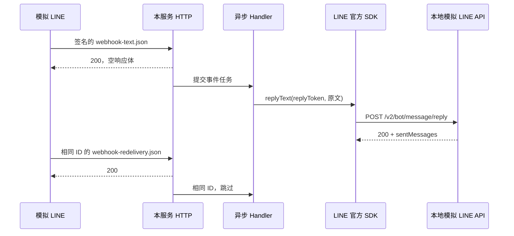

# LINE Messaging API 接口文档

版本：1.1.2
更新日期：2026-10-13（Asia/Shanghai）
实现基线：Webhook、Reply Echo、Push、消息工厂、受保护的内部调试接口和有限重试；以本次提交代码为准。

本文描述当前代码的实际行为。所有示例中的 userId、messageId、webhookEventId、Reply Token、Quote Token、订单号和地址均为虚构模拟数据，不是线上抓包，也不能作为真实 LINE 凭证使用。示例复用一组 ID 关联入站与出站，便于跟踪。

## 1. 接口总览

代码按功能分包：`com.example.line.webhook` 接收消息（含 `signature`、`dedup`、`handler` 子包），
`messaging` 发送消息（内部调试接口位于 `messaging.internal`），`content` 下载内容，
`client` 装配 SDK 客户端，`common.exception` 统一处理异常，`common.web` 提供健康接口。
测试包同步镜像生产包；跨功能联调测试 `DocumentedFlowIntegrationTest` 保留在根包。
本次只调整源码位置和包引用，HTTP 接口、数据字段、配置键与 LINE 出站协议保持原有契约。

| 方向 | 方法与地址 | 当前状态 | 用途 |
| --- | --- | --- | --- |
| 调用方 → 本服务 | `GET /health` | 已实现 | 检查应用是否启动 |
| LINE → 本服务 | `POST /line/webhook` | 已实现 | 接收消息、关注、取消关注、Postback |
| 本服务 → LINE | `POST https://api.line.me/v2/bot/message/reply` | 已实现，内部调用 | 回复本次消息 |
| 本服务 → LINE | `GET https://api-data.line.me/v2/bot/message/{messageId}/content` | 已提供内部下载方法，未自动触发 | 下载图片或文件内容 |
| 本服务 → LINE | `POST https://api.line.me/v2/bot/message/push` | 已实现 | 主动推送，携带 Retry Key |
| 内部调试方 → 本服务 | `POST /internal/push` | 已实现，默认关闭 | 鉴权后同步推送一条文本 |

本服务没有开放 `/reply`、`/push` 或 `/content` HTTP 接口，调试发送路径为 `/internal/push`。Reply 由消息 Handler 调用，内容下载由业务代码按需调用。默认本地地址为 `http://localhost:8080`；对接 LINE 时使用公网可访问的 HTTPS 地址。

## 2. 配置、鉴权与日志

| 配置 | 来源或默认值 | 说明 |
| --- | --- | --- |
| `line.bot.channel-secret` | `LINE_CHANNEL_SECRET` | 验证 LINE Webhook 签名 |
| `line.bot.channel-token` | `LINE_CHANNEL_TOKEN` | SDK 出站 Bearer Token |
| `server.port` | `8080` | 本地监听端口 |
| `line.webhook.workers` | `4` | 固定工作线程数 |
| `line.webhook.queue-capacity` | `256` | 等待任务上限，按请求计 |
| `line.webhook.dedup-ttl` | `24h` | 成功事件去重保留时间 |
| `line.webhook.dedup-max-entries` | `10000` | 去重缓存容量，包含处理中事件 |
| `line.webhook.content-max-bytes` | `10485760` | 下载最多 10 MiB |
| `line.send.max-attempts` | `3` | Push 总尝试次数，允许 1..5，含首次 |
| `line.send.attempt-timeout` | `3s` | 每次 SDK Future 等待上限，必须 >0 且 ≤5s |
| `line.send.initial-backoff` | `200ms` | Push 首次退避，必须 >0 且 ≤1s |
| `line.internal-push.enabled` | `LINE_INTERNAL_PUSH_ENABLED`，默认 false | 内部调试发送开关 |
| `line.internal-push.token` | `LINE_INTERNAL_PUSH_TOKEN`，默认空 | 独立 header token；开关启用时非空 |

两个凭证缺失或为空白时启动失败，报错只列配置名。凭证可通过环境变量或外部 Spring 配置提供，不写入代码和文档。

启用内部发送但未提供 token 时启动失败，明确提示 `LINE_INTERNAL_PUSH_TOKEN`。默认关闭时不要求配置该 token。该 token 与 Channel Secret、Access Token 不同，禁止复用真实 LINE 凭证。

Webhook 不使用 Bearer Token，通过 `X-Line-Signature` 验证。Reply/Content 则使用 `Authorization: Bearer <Channel Access Token>`；Channel Secret 不用于出站鉴权。

SDK 两个客户端均关闭默认 HTTP 报文日志：`usingDefaultLogger(false)`；配置同时关闭 `com.linecorp.bot.client.wire` logger。不要重新启用请求头/请求体日志。业务日志仅记录事件类型、eventId、消息类型、messageId，以及关注/取消关注的 userId。

## 3. GET /health

无需请求体和鉴权。示例：

```http
GET /health HTTP/1.1
Host: localhost:8080
```

返回：

```http
HTTP/1.1 200
Content-Type: application/json

{"status":"UP"}
```

只代表应用运行，不验证 LINE 凭证有效性，也不代表出站网络可达。

## 4. POST /line/webhook：LINE 发来的数据

### 4.1 请求头与签名

```http
POST /line/webhook HTTP/1.1
Host: localhost:8080
Content-Type: application/json
X-Line-Signature: <按本次原始请求字节计算的 Base64 签名>
```

签名算法：

```text
Base64(HMAC-SHA256(key=UTF8(Channel Secret), data=原始请求体字节))
```

服务先验证原始字节，再提交异步任务；不会先把 JSON 格式化后验签。
验签实现为 JDK Mac，比较使用 `MessageDigest.isEqual`，没有使用 SDK Spring Boot starter。
换行、空格、中文编码等字节变化都需要重新签名。[官方签名说明](https://developers.line.biz/en/docs/messaging-api/verify-webhook-signature/)

### 4.2 顶层及事件公共字段

| 字段 | 类型 | 含义与本服务使用方式 |
| --- | --- | --- |
| `destination` | string | 接收事件的 Bot 用户 ID；当前未与配置中的 Bot ID 做二次比对 |
| `events` | array | SDK 事件列表，可为空；缺失/null 会异步记录警告 |
| `events[].type` | string | 事件类型，如 message、follow、unfollow、postback |
| `events[].webhookEventId` | string | 幂等键；缺失/空白事件会跳过 |
| `events[].timestamp` | integer | 事件时间，Unix 毫秒；不是幂等键 |
| `events[].mode` | string | active/standby；消息事件为 standby 时不回复 |
| `events[].deliveryContext.isRedelivery` | boolean | 是否重投递，仅记录该标志，不据此直接丢弃 |
| `events[].source.type` | string | user/group/room，示例使用 user |
| `events[].source.userId` | string | 用户标识；部分来源场景可能缺失 |
| `events[].replyToken` | string | 可回复事件的临时 Token；与 Channel Access Token 不同，不能长期缓存或重复使用 |
| `events[].message` | object | message 事件的具体内容 |
| `events[].postback` | object | postback 事件的数据 |

这是本项目使用的字段说明，不是对 LINE 全量字段的穷举。SDK 负责解析模型，代码未给每个字段增加严格的 Bean Validation；某些字段无效会在异步业务中报错，而不是改变已经返回的 HTTP 200。

### 4.3 完整文本请求

模拟用户发送“你好，我想查询订单 A202610130001”。当前服务只回显原文，没有对接订单系统。
可发送文件：[webhook-text.json](examples/webhook-text.json)。

```json
{
  "destination": "Ubbbbbbbbbbbbbbbbbbbbbbbbbbbbbbbb",
  "events": [
    {
      "type": "message",
      "webhookEventId": "01K7B1N0000000000000000001",
      "timestamp": 1791869400000,
      "mode": "active",
      "deliveryContext": {
        "isRedelivery": false
      },
      "source": {
        "type": "user",
        "userId": "Uaaaaaaaaaaaaaaaaaaaaaaaaaaaaaaaa"
      },
      "replyToken": "00000000000000000000000000000001",
      "message": {
        "type": "text",
        "id": "537629183902001",
        "text": "你好，我想查询订单 A202610130001",
        "quoteToken": "mock-incoming-quote-token"
      }
    }
  ]
}
```

关联关系：

- 入站 `message.id=537629183902001` 用于标识用户这条消息。
- 入站 `webhookEventId=01K7B1N0000000000000000001` 用于去重。
- 入站 `replyToken` 被复制到后续 Reply 请求。
- 出站 `messages[0].text` 等于入站 `message.text`。
- LINE 成功响应中的 `sentMessages[].id` 标识 Bot 发出的新消息，与入站 messageId 不同。

### 4.4 其他消息与事件的完整模拟文件

以下每个文件都包含完整顶层与公共字段，可直接交给签名测试脚本。消息中的数值和字符串与示例类型一致。

| 模拟文件 | 事件与关键内容 | 当前行为 |
| --- | --- | --- |
| [webhook-image.json](examples/webhook-image.json) | message/image，id=537629183902002，contentProvider.type=line | 记录类型、messageId，回复“暂不支持” |
| [webhook-sticker.json](examples/webhook-sticker.json) | message/sticker，packageId=446，stickerId=1988 | 同上 |
| [webhook-location.json](examples/webhook-location.json) | message/location，latitude=25.0478，longitude=121.517 | 同上 |
| [webhook-file.json](examples/webhook-file.json) | message/file，fileName=order-A202610130001.pdf，fileSize=24576 | 同上，不直接使用用户文件名落盘 |
| [webhook-follow.json](examples/webhook-follow.json) | follow，source.userId，follow.isUnblocked=false | 记录 userId，不自动回复 |
| [webhook-unfollow.json](examples/webhook-unfollow.json) | unfollow，无 replyToken | 记录 userId，不回复 |
| [webhook-postback.json](examples/webhook-postback.json) | postback.data=action=query_order&orderId=A202610130001 | 记录 eventId，业务入口预留，不自动查询订单或回复 |
| [webhook-redelivery.json](examples/webhook-redelivery.json) | 与文本事件相同 ID，isRedelivery=true | 原事件成功/处理中时跳过；第一次看到此 ID 时处理 |
| [webhook-empty.json](examples/webhook-empty.json) | events=[] | 返回 200，无业务事件 |

音频、视频等其他可解析消息也回复“暂不支持”。图片/文件不会自动下载。
SDK 能解析但未注册 Handler 的事件只记录未支持类型；SDK 不能解析的类型可能导致整个请求解析失败，记录警告，不保证同一请求内其他事件仍处理。

### 4.5 本服务返回给 LINE 的响应

| 场景 | HTTP 状态 | 响应体/业务行为 |
| --- | --- | --- |
| 正确签名、有非空请求体 | 200 | 空响应体；尝试入队，不等待解析或 Reply |
| 正确签名、events=[] | 200 | 空响应体；无业务事件 |
| 重复事件 | 200 | 空响应体；异步跳过重复 ID |
| 缺失/非法 Base64/不匹配签名 | 400 | Controller 返回空响应体，不入队 |
| 空请求体 | 400 | Spring MVC 请求体校验失败；响应格式由框架处理 |
| 正确签名但 JSON 错误、events 缺失 | 200 | 异步日志记录解析/格式问题 |
| 线程池满/已关闭 | 200 | ERROR 拒绝日志；任务未处理 |
| Reply 失败、超时、缓存满 | 200 | HTTP 已确认；异步记录失败 |

**Webhook 的 200 是接收确认，不是消息发送成功回执。** 接口没有返回 Reply 结果或业务任务 ID，当前也没有查询任务状态的接口。

空请求体由统一异常处理返回 `{"code":"INVALID_REQUEST","upstreamStatus":null}`。
消息事件入队或同批处理等待超过 15 秒会跳过 Reply 并记录日志；此时 HTTP 仍为 200。
时长从本次 HTTP 接收计时，不按 LINE 的原始 timestamp 判断，避免误判重投递。

## 5. 消息发送：Reply 与 Push

### 5.1 请求与文本示例

```http
POST /v2/bot/message/reply HTTP/1.1
Host: api.line.me
Authorization: Bearer <从环境变量读取的 Channel Access Token>
Content-Type: application/json
```

与第 4.3 节入站文本对应的请求：[reply-text-request.json](examples/reply-text-request.json)。

```json
{
  "replyToken": "00000000000000000000000000000001",
  "messages": [
    {
      "type": "text",
      "text": "你好，我想查询订单 A202610130001"
    }
  ]
}
```

| 字段 | 类型 | 当前构造规则 |
| --- | --- | --- |
| `replyToken` | string | 来自该事件的 replyToken；缺失/空白时本地失败 |
| `messages` | array | 通用封装校验 1..5 条非 null 消息；echo 当前发送 1 条 |
| `messages[0].type` | string | 当前为 text |
| `messages[0].text` | string | 文本事件原文，其他消息为“暂不支持” |

当前不设置 `notificationDisabled` 等可选字段，不进行自定义分段或转换。
Reply Token 必须使用真实 LINE 当次事件中的有效 Token；模拟文件中的 Token 只能交给本地模拟服务器验证格式。Reply 与 Token 规则以 [LINE Reply 文档](https://developers.line.biz/en/reference/messaging-api/#send-reply-message) 为准。

图片请求对应的出站数据：[reply-image-request.json](examples/reply-image-request.json)。

```json
{
  "replyToken": "00000000000000000000000000000002",
  "messages": [
    {
      "type": "text",
      "text": "暂不支持"
    }
  ]
}
```

贴图、位置、文件与上述结构相同，但 replyToken 必须取自各自事件，不能复用图片事件的 Token。

### 5.2 LINE 返回给本服务的数据

成功响应示例：[reply-success-response.json](examples/reply-success-response.json)。

```http
HTTP/1.1 200
Content-Type: application/json
X-Line-Request-Id: <LINE 请求追踪 ID>
```

```json
{
  "sentMessages": [
    {
      "id": "537629183903001",
      "quoteToken": "mock-outgoing-quote-token"
    }
  ]
}
```

`sentMessages[].id` 是发出的消息 ID，`quoteToken` 可在支持引用的场景出现。当前代码等待 SDK 结果，但不把这些字段返回给 Webhook 调用方，也不持久化。
发送失败时 SDK 抛异常，例如无效/已失效的 Reply Token 可能产生 400；具体错误由 LINE 判定，不作为本服务入站错误码透传。

LINE 错误响应形状示例（虚构）：

```json
{"message":"Invalid reply token"}
```

Reply 默认等待 SDK 最多 3 秒，不自动重试，不向 Webhook 响应追加错误信息。
replyToken 一次性且有效期很短，不持久化、不延迟调度、不用于 Push。Reply 不支持 Retry Key，
因此即使 5xx/网络异常也不盲目重发；当前不自动切换 Push，以免造成重复消息或额外额度消耗。

Reply 免费且不计入月度消息额度，Push 会消耗额度；能及时回复的业务优先用 Reply。
具体套餐与计数以 [LINE Pricing](https://developers.line.biz/en/docs/messaging-api/pricing/) 为准。

### 5.3 内部调试接口 POST /internal/push

默认关闭；以下行为基于合法的非空 JSON 请求体。JSON 绑定发生在 Controller 鉴权前，非法 JSON 会直接返回 400。

```http
POST /internal/push HTTP/1.1
Host: localhost:8080
Content-Type: application/json
X-Internal-Token: <从 LINE_INTERNAL_PUSH_TOKEN 配置的独立调试 token>

{"userId":"Uaaaaaaaaaaaaaaaaaaaaaaaaaaaaaaaa","text":"hello from push"}
```

完整模拟文件：[internal-push-request.json](examples/internal-push-request.json)。

| 字段 | 规则 |
| --- | --- |
| `userId` | 必须为 U + 32 个小写十六进制字符，当前接口只接受用户 ID |
| `text` | 非空白，最多 5000 个 UTF-16 单元 |

成功返回 HTTP 200；[响应样例](examples/internal-push-success-response.json)：

```json
{
  "status": "ACCEPTED",
  "retryKey": "123e4567-e89b-12d3-a456-426614174000",
  "alreadyAccepted": false
}
```

retryKey 每次方法调用由服务生成；以上 UUID 为虚构样例。
ACCEPTED 表示 LINE 接受请求，不保证用户已收到或读取。
alreadyAccepted=true 表示同一 Retry Key 的请求已被 LINE 接受（409 带 accepted-request-id），无需再发送。

| 场景 | HTTP | 响应 |
| --- | --- | --- |
| 接口关闭 | 404 | 空响应体，不调用 LINE |
| token 缺失/不匹配 | 401 | 空响应体，不调用 LINE |
| 字段或 JSON 无效 | 400 | `{"code":"INVALID_REQUEST","upstreamStatus":null}` |
| LINE 4xx（包括鉴权、参数、429） | 502 | `{"code":"LINE_CLIENT_ERROR","upstreamStatus":401}`，status 值依实际错误 |
| LINE 5xx 重试耗尽 | 503 | `{"code":"LINE_TRANSIENT_FAILURE","upstreamStatus":503}` |
| 网络/超时重试耗尽 | 503 | `{"code":"LINE_TRANSIENT_FAILURE","upstreamStatus":null}` |
| 调用被中断 | 503 | `{"code":"LINE_INTERRUPTED","upstreamStatus":null}`，上游状态如已知则保留 |
| 非预期 SDK 错误 | 502 | `{"code":"LINE_UNEXPECTED_FAILURE","upstreamStatus":null}`，上游状态如已知则保留 |

出站 LINE 鉴权失败不映射成本地 401，避免与内部 header token 错误混淆。
错误体只包含分类与上游状态，不包含 SDK 原始错误消息、请求体或凭证。

### 5.4 Push 出站请求与有限重试

`LineMessageService.pushText(userId,text)` 封装到下面请求：

```http
POST /v2/bot/message/push HTTP/1.1
Host: api.line.me
Authorization: Bearer <Channel Access Token>
Content-Type: application/json
X-Line-Retry-Key: 123e4567-e89b-12d3-a456-426614174000

{"to":"Uaaaaaaaaaaaaaaaaaaaaaaaaaaaaaaaa","messages":[{"type":"text","text":"hello from push"}]}
```

完整文件：[push-text-request.json](examples/push-text-request.json)。
成功响应包含 sentMessages，结构参考 Reply 成功样例。

- 首次请求就包含随机 UUID Retry Key，同一次自动重试保留相同接收人、消息体和 Key。
- 默认最多 3 次尝试，单次等待 3s，重试前退避 200ms、400ms；配置可以调小，最大次数为 5。
- 只重试 5xx、网络 IOException 和超时；4xx 含 429 不重试。
- 409 仅在带有非空 `X-Line-Accepted-Request-Id` 时视为已接受，否则作为 4xx 失败。
- 中断会恢复线程中断标记并立即停止；超时会尝试取消 Future，但取消不证明远端未执行。
- 每次重新调用内部接口/服务都会生成新 Key；调用方重复 POST 不是同一次自动重试，仍可能重复推送。
- 当前不持久化 Retry Key，也不提供跨进程或跨重启的后台重试。

[官方 Retry Key 规则](https://developers.line.biz/en/docs/messaging-api/retrying-api-request/)。

### 5.5 多消息构造与 5 条上限

`replyMessages(replyToken,List<Message>)` 与 `pushMessages(userId,List<Message>)`
共享 1..5 条校验。0 条、6 条、null 列表或 null 元素都在调用 SDK 前失败，不自动拆分批次。
Quick Reply 选项嵌套在一条消息中，不占用额外根消息数量。

```java
List<Message> messages = List.of(
    LineMessages.text("hello"),
    LineMessages.sticker("446", "1988"),
    LineMessages.image(
        URI.create("https://example.com/order.png"),
        URI.create("https://example.com/order-preview.png")),
    LineMessages.flexCard("订单通知", "订单 A202610130001 已发货"),
    LineMessages.quickReply("请选择操作",
        List.of(new LineMessages.QuickOption("查询订单", "查询订单")))
);
lineMessageService.pushMessages(userId, messages);
// 也可以在当前事件中立即使用 replyMessages(replyToken, messages)。
```

与工厂实际序列化逐字段匹配的完整五条 JSON：
[push-five-messages-request.json](examples/push-five-messages-request.json)。
example.com 图片 URL 仅说明格式，需要替换为 LINE 能访问的真实 HTTPS 图片。
入站图片/贴图等的默认 Handler 仍回复“暂不支持”；出站工厂不会改变这些入站业务行为。

工厂校验：文本 ≤5000 UTF-16 单元；贴图 ID 为数字；图片 URI 为不含用户凭证的绝对 HTTPS URL；
简单 Flex 模板 title ≤100、body ≤1000；Quick Reply 为 1..13 个 MessageAction，
label ≤20、所发文本 ≤5000。工厂不校验线上贴图授权、图片格式/大小或可达性，由 LINE 最终判定。

## 6. Content：按 messageId 获取用户发来的文件

这是一条本服务调用 LINE 的出站请求，不是 LINE 再主动发送文件，也不是本服务对外 HTTP 接口。

文件示例的调用：

```http
GET /v2/bot/message/537629183902005/content HTTP/1.1
Host: api-data.line.me
Authorization: Bearer <Channel Access Token>
```

LINE 成功返回二进制流，`Content-Type` 依内容而定，例如 `application/pdf`；不是 JSON/Base64 包装。
对应内部方法：

```java
long bytes = lineContentService.downloadTo("537629183902005", outputStream);
```

图片使用 `537629183902002`。需要可用真实 messageId 与有效 Token。
图片 contentProvider=external 时本示例不抓取外部 URL；不要把它当成 line 内容直接调用。

当前实现流式复制，超过 10 MiB 抛异常并关闭上游流；调用方负责关闭输出流、清理部分文件和配置存储路径。
`getMessageContent` Future 等待上限为 20 秒，此限制不代表整个流复制总时长的独立截止时间。[官方 Content API](https://developers.line.biz/en/reference/messaging-api/#get-content)

## 7. 可复现的模拟对接流程

### 7.1 完整本地联调：同时验证收和发，不调用真实 LINE

在仓库根目录执行：

```powershell
mvn -Dtest=DocumentedFlowIntegrationTest test
```

不需要真实 LINE 账号、Secret 或 Access Token。测试使用明确的虚构测试配置，只在测试环境覆盖两个 SDK 客户端目标地址，生产 Bean 的目标仍为 LINE 官方域名。

执行链路：



测试执行以下真实 HTTP/SDK 步骤并断言数据，不只是打印示意 JSON：

1. 加载文档中的 text 文件，错误签名返回 400，未发出 Reply。
2. 对同一文件原始字节计算正确签名，发送到真实启动的 Spring Boot 随机端口，返回 200。
3. 工作线程解析并分发，官方 SDK 发起实际 HTTP POST 到本地 Stub。
4. 捕获请求方法、Bearer 鉴权头和序列化 JSON，逐字段比较 `reply-text-request.json`。
5. Stub 按 `reply-success-response.json` 返回 200。
6. 发送 redelivery 文件，相同事件 ID 不产生第二条 Reply。
7. 分别发送 image/sticker/location/file，验证各自 Reply Token 与“暂不支持”消息。
8. 发送 follow/unfollow/postback/empty，确认不会发出 Reply。
9. 显式调用 Content 服务，SDK 向 Stub 发出实际 GET，读取并关闭模拟二进制流。
10. 检查日志不出现测试凭证、Reply Token、鉴权头或文本内容。

扩展步骤：加载 [webhook-hello.json](examples/webhook-hello.json)，验证 SDK 出站正好是
[reply-hello-request.json](examples/reply-hello-request.json)；
通过内部 Push 接口发起请求，Stub 先返回 503 再返回 200，断言两次 HTTP 的 Retry Key 与请求体一致；
再模拟带 accepted-request-id 的 409，验证返回 alreadyAccepted=true。

Stub 的文件内容为 `mock-binary-content`（19 字节），仅用于流传输断言，不是真实 PDF。
模拟服务器不验证线上 Token 的有效性、频控、配额或实际用户收件。
生产日志不会输出收发原文；测试在内存捕获与比对数据。全部测试执行 `mvn test`。

### 7.2 手工 curl 验签与事件观察

先在终端 A 设置凭证环境变量并启动；若只验证 follow/验签，可通过进程环境注入虚构的非空配置，无需真实 LINE 凭证。

```powershell
mvn spring-boot:run
```

终端 B 必须设置与服务相同的 `LINE_CHANNEL_SECRET`。发送不会触发出站 Reply 的 follow 示例：

```powershell
powershell -ExecutionPolicy Bypass -File scripts/Send-TestWebhook.ps1 -BodyPath docs/examples/webhook-follow.json
# 200；后台 Follow 日志包含 Uaaaaaaaaaaaaaaaaaaaaaaaaaaaaaaaa

powershell -ExecutionPolicy Bypass -File scripts/Send-TestWebhook.ps1 -BodyPath docs/examples/webhook-follow.json -InvalidSignature
# 400；不处理事件
```

同一 follow 文件重复发送仍返回 200，并记录 duplicate。JSON 的任何编辑都由脚本重新签名。
脚本也支持 `-Url` 指定其他服务地址。

不要把 text/image 等虚构 Reply Token 示例直接发给连接真实 LINE API 的运行实例，期望模拟出真实发送成功；其 HTTP 200 仍只是入站确认，出站调用会失败。使用第 7.1 节测试完成虚构文本的双向联调。

### 7.3 使用真实 LINE 账号对接

1. 创建并配置 Messaging API Channel，把 Channel Secret 与 Access Token 注入服务环境。
2. 部署到 LINE 可访问的公网 HTTPS 地址，在 LINE Developers Console 设置 `https://<你的域名>/line/webhook` 并启用 Webhook。
3. 验证 Webhook 地址；`events=[]` 的验证请求应返回 200。
4. 测试用户添加官方账号，观察 follow 与 userId 日志。
5. 在 LINE 客户端发送 `hello`，应立即收到 `hello` 回声。确认日志出现 MessageEvent、没有 LINE send failed；不要把 Webhook 的 200 单独当作回声验收成功。
6. 发送图片/文件/贴图/位置，应收到“暂不支持”；下载仍需业务显式调用 Content 服务。
7. 测试取消关注与 Postback，观察对应 Handler 日志。Postback 需要由含 Postback action 的菜单/消息触发，当前服务不负责生成这些 UI。
8. 核对官方账号自动回复/欢迎消息设置，避免与服务回复造成重复体验。

真实环境需要对方账号、可用 Token、可达网络，不能用第 7.1 节结果替代线上验收。
Webhook 接收与重投递的官方说明：[Receive messages](https://developers.line.biz/en/docs/messaging-api/receiving-messages/)。

## 8. 幂等、失败与限制

- 依据 webhookEventId 原子去重，成功后保留 24h，处理中不因 TTL 到期释放。
- isRedelivery=true 不等于重复：未见过该 ID 仍处理。
- 同一请求内按顺序处理事件，不同请求可能并行，不保证全局消息顺序。
- 缺失 ID 会跳过；成功/处理中重复事件不会再次执行 Handler。
- Handler 异常释放 ID；后续再次投递可重试，但服务不自动请求 LINE 重投递。
- 内存缓存单进程有效，重启清空、多个实例不共享；缓存满会记录处理失败。
- 请求队列满仍返回 200，该任务会丢失；异步解析/发送失败也不会把已经发送的 200 改成错误。
- SDK 调用超时不证明远端未执行，仍可能存在重复副作用，不保证 exactly-once。
- Reply 在本次接收后等待超过 15 秒时跳过；不会保存 token 供日后发送。
- Push 有限重试仅覆盖单次调用，不代表可靠投递；内部接口重复 POST 会生成新 Key。

## 9. 文档维护要求与变更记录

后续新增、修改或删除接口时，同一次交付必须更新本文、对应 JSON 示例与必要的契约测试。
检查内容包括：路径/方法、请求与响应、字段可选性、鉴权、错误码、出站 API、事件行为、异步确认、幂等、配置默认值、运行与验证步骤。
不影响接口契约的内部重构可在交付说明中注明无需修改接口文档。
执行规则也已写入仓库根目录 `AGENTS.md`。

| 日期 | 版本 | 变更 |
| --- | --- | --- |
| 2026-10-13 | 1.1.2 | 源码与测试改为按功能分包，更新包位置说明与文档路径；HTTP 接口、配置键、数据示例和出站协议不变 |
| 2026-10-13 | 1.0.0 | 首次完整接口文档；加入 13 份模拟 JSON、双向 HTTP 联调测试；关闭 SDK 默认敏感报文日志；规定后续接口变更同步更新 |
| 2026-10-13 | 1.1.0 | Push 与受保护调试接口；五类消息工厂；1..5 条校验；统一错误分类、Push Retry Key 与指数退避；即时 Reply 与积压保护；hello 联调示例；共 20 份模拟 JSON |
| 2026-10-13 | 1.1.1 | README 补齐官方 Channel 创建、Secret/Token、自动消息关闭、HTTPS 隧道和 Docker 环境注入；扩展签名/Handler/幂等测试；加入自查报告，接口请求响应未改变 |

文档与代码映射：健康接口 `HealthController`；接收入口 `WebhookController`；验签 `SignatureVerifier`；
解析/幂等 `WebhookService/EventDeduplicator`；策略 `EventDispatcher/EventHandler`；
回复 `LineMessageService`；下载 `LineContentService`；配置 `LineClientConfig/WebhookConfig`；
文档联调 `DocumentedFlowIntegrationTest`。

消息发送相关新增文件：`LineSendProperties/LineSendConfig/InternalPushProperties`、
`LineApiCaller/LineSendException/LineMessages`、`InternalPushController/ApiExceptionHandler`。
相关修改：`LineMessageService`、`WebhookService`、`application.yml`。
验证覆盖：`LineApiCallerTest`、`LineMessageServiceTest`、`LineMessagesTest`、
`InternalPushControllerTest`、`WebhookServiceTest` 与 `DocumentedFlowIntegrationTest`。

## 10. 手工 Push 调试

确认真实 echo 后，按需启用调试接口；不要使用 LINE 凭证作为调试 token。
通过部署环境或当前进程环境设置 `LINE_INTERNAL_PUSH_ENABLED=true` 和独立的非空
`LINE_INTERNAL_PUSH_TOKEN`，重启 `mvn spring-boot:run`。终端中的 token 与服务配置保持一致。
userId 使用本次 Channel 下的真实用户 ID，可从关注事件日志获取。

```powershell
$body = @{ userId = '<真实的 U 开头 userId>'; text = 'hello from push' } | ConvertTo-Json -Compress
Invoke-RestMethod -Method Post -Uri 'http://localhost:8080/internal/push' -ContentType 'application/json' -Headers @{
    'X-Internal-Token' = $env:LINE_INTERNAL_PUSH_TOKEN
} -Body ([System.Text.Encoding]::UTF8.GetBytes($body))
```

预期返回 ACCEPTED、retryKey、alreadyAccepted，用户看到 hello from push。
调试结束将开关恢复 false；不要自动重发失败的 POST，因为再次调用会产生新 Key。
当前未配置真实 Channel 凭证的本地模拟测试不产生真实推送或计费。

## 11. 部署、测试与自查索引

控制台配置、ngrok/cloudflared、Dockerfile、docker-compose.yml 与 .env.example 的使用见
[README](../README.md)。Compose 从环境或被忽略的 .env 注入必需密钥，不在镜像构建时传入。
默认映射 127.0.0.1:8080；公网 HTTPS 仍由隧道/代理提供；内部 Push 默认关闭。

本次 `mvn verify`：55 个测试通过。Compose 配置及缺失环境变量分支已验证；
Docker 引擎未运行，镜像构建/启动尚未执行。部署前阅读 [自查报告](自查报告.md)，
特别是队列满返回 200 会丢事件、内存幂等不跨实例，以及签名正确并不阻止已签名请求重放等剩余限制。
