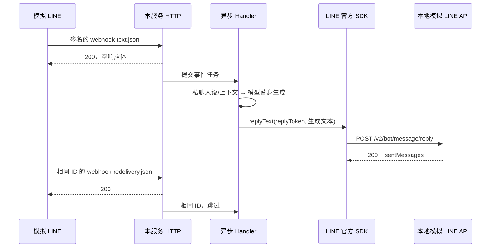

# LINE Messaging API 接口文档

版本：1.5.0
更新日期：2026-10-15（Asia/Shanghai）
实现基线：P0 全部能力与 P1 单实例私聊 AI（OpenAI Responses、人设、Redis 上下文/锁/限流、有界 FIFO、删除屏障）；群聊/聊天室保留文本回显。

本文描述当前代码的实际行为。所有示例中的 userId、messageId、webhookEventId、Reply Token、Quote Token、订单号和地址均为虚构模拟数据，不是线上抓包，也不能作为真实 LINE 凭证使用。示例复用一组 ID 关联入站与出站，便于跟踪。

本文是接口、配置、运行与部署的统一维护入口。表结构与删除扩展见 [数据库设计](数据库设计.md)，
日志字段及事件登记见 [日志规范](日志规范.md)，P0 需求与验收依据见 [P0 任务文档](P0任务文档.md)。
README 仅保留导航；历史交付副本与自查报告不在项目内维护。

## 1. 接口总览

代码按功能分包：`com.example.line.webhook` 接收消息（含 `signature`、`dedup`、`handler` 子包），
`messaging` 发送消息（内部调试接口位于 `messaging.internal`），`content` 下载内容，
`ai.generation` 隔离模型与人设，`ai.memory` 提供热缓存，`ai.coordination` 管理有界会话与删除；
`client` 装配 SDK 客户端，`common.exception` 统一处理异常，`common.web` 提供健康接口。
测试包同步镜像生产包；跨功能联调测试 `DocumentedFlowIntegrationTest` 保留在根包。
`user`、`chat`、`common.persistence` 提供业务持久化，`audit` 提供敏感操作记录，`common.logging` 及 `recording` 子包提供链路、事件队列与批写。
业务端口所有 HTTP 响应带 `X-Trace-Id`，HTTP 请求/响应体与状态码保持原有契约；私聊文本改用 AI，具体规则见第 2.5 节。

| 方向 | 方法与地址 | 当前状态 | 用途 |
| --- | --- | --- | --- |
| 调用方 → 本服务 | `GET /health` | 已实现 | 检查应用是否启动 |
| LINE → 本服务 | `POST /line/webhook` | 已实现 | 接收消息、关注、取消关注、Postback |
| 本服务 → LINE | `POST https://api.line.me/v2/bot/message/reply` | 已实现，内部调用 | 回复本次消息 |
| 本服务 → LINE | `GET https://api-data.line.me/v2/bot/message/{messageId}/content` | 已提供内部下载方法，未自动触发 | 下载图片或文件内容 |
| 本服务 → LINE | `POST https://api.line.me/v2/bot/message/push` | 已实现 | 主动推送，携带 Retry Key |
| 内部调试方 → 本服务 | `POST /internal/push` | 已实现，默认关闭 | 鉴权后同步推送一条文本 |
| 本服务 → OpenAI | `POST https://api.openai.com/v1/responses` | 已实现，内部调用 | active 一对一私聊文本生成 |
| 本机运维 → 管理端口 | `GET http://127.0.0.1:9090/actuator/health`、`/actuator/info`、`/actuator/metrics` | 已实现 | 健康、服务信息与指标；仅回环地址 |

本服务没有开放 `/reply`、`/push` 或 `/content` HTTP 接口，调试发送路径为 `/internal/push`。Reply 由消息 Handler 调用，内容下载由业务代码按需调用。默认本地地址为 `http://localhost:8080`；对接 LINE 时使用公网可访问的 HTTPS 地址。

## 2. 配置、鉴权与日志

| 配置 | 来源或默认值 | 说明 |
| --- | --- | --- |
| `line.bot.channel-secret` | `LINE_CHANNEL_SECRET` | 验证 LINE Webhook 签名 |
| `line.bot.channel-token` | `LINE_CHANNEL_TOKEN` | SDK 出站 Bearer Token |
| `server.port` | `8080` | 本地监听端口 |
| `line.webhook.workers` | `4` | 固定工作线程数 |
| `line.webhook.queue-capacity` | `256` | 等待任务上限，按请求计 |
| `line.webhook.dedup-ttl` | `24h` | 成功事件去重保留时间 |
| `line.webhook.dedup-max-entries` | `10000` | 去重缓存容量，包含处理中事件 |
| `line.webhook.content-max-bytes` | `10485760` | 下载最多 10 MiB |
| `line.send.max-attempts` | `3` | Push 总尝试次数，允许 1..5，含首次 |
| `line.send.attempt-timeout` | `3s` | 每次 SDK Future 等待上限，必须 >0 且 ≤5s |
| `line.send.initial-backoff` | `200ms` | Push 首次退避，必须 >0 且 ≤1s |
| `line.internal-push.enabled` | `LINE_INTERNAL_PUSH_ENABLED`，默认 false | 内部调试发送开关 |
| `line.internal-push.token` | `LINE_INTERNAL_PUSH_TOKEN`，默认空 | 独立 header token；开关启用时非空 |
| `line.database.url` | `DATABASE_URL`，无默认值 | 必需；PostgreSQL JDBC 地址，只从运行环境注入 |
| `line.database.username` | `DATABASE_USERNAME`，无默认值 | 必需；数据库账号 |
| `line.database.password` | `DATABASE_PASSWORD`，无默认值 | 必需；数据库密码，不输出到日志 |
| `line.database.pool-size` | `DATABASE_POOL_SIZE`，默认 8 | 业务连接池最大连接数 |
| `line.database.connection-timeout-ms` | `DATABASE_CONNECTION_TIMEOUT_MS`，默认 3000 | 获取业务连接超时，最小 250ms |
| `line.persistence.workers` | 2 | 独立落库线程数 |
| `line.persistence.queue-capacity` | 512 | 落库任务队列上限，满时丢弃记录，不阻塞回复 |
| `line.persistence.shutdown-timeout` | 30s | 落库执行器停机等待预算 |
| `line.persistence.cleanup-batch-size` | 500 | 每次调度删除条数上限 |
| `line.chat.cleanup-enabled` | `CHAT_CLEANUP_ENABLED`，默认 false | 聊天自动清理独立开关 |
| `line.chat.retention-days` | `CHAT_RETENTION_DAYS`，默认 90 | 开启清理后使用的保留天数 |
| `line.chat.cleanup-interval` | `CHAT_CLEANUP_INTERVAL`，默认 1h | 清理任务首次延迟与后续间隔 |
| `line.chat.history-max-limit` | 100 | Java 历史查询条数上限 |
| `line.logging.service` | `APP_SERVICE`，默认 line-messaging-service | 固定日志服务名，非空白 |
| `line.logging.env` | `APP_ENV`，默认 local | 固定环境名；生产部署显式设置 production |
| `line.logging.version` | `APP_VERSION`，默认 0.0.1-SNAPSHOT | 固定应用版本，非空白 |
| `line.logging.instance` | `APP_INSTANCE`，未设置时依次取 HOSTNAME、COMPUTERNAME、local | 实例标识；Compose 默认 local，可覆盖 |
| `line.logging.readable-file` | `LOCAL_LOG_FILE`，默认 logs/application-readable.log | 仅 local profile 额外写入的易读文件 |
| `spring.profiles.active` | `SPRING_PROFILES_ACTIVE`，默认无显式 profile | 设置 local 才启用额外易读文件，stdout 始终 JSON |
| `line.event-recorder.queue-capacity` | `LOG_QUEUE_CAPACITY`，默认 4096 | 事件与审计共用的有界内存队列容量 |
| `line.event-recorder.batch-size` | `LOG_BATCH_SIZE`，默认 100 | 后台单批最大记录数 |
| `line.event-recorder.flush-interval` | `LOG_FLUSH_INTERVAL`，默认 1s | 空队列最长轮询间隔；已到达记录立即开始批写，不额外等待凑满 |
| `line.event-recorder.pool-size` | `LOG_POOL_SIZE`，默认 2 | 独立日志池最大连接数，与业务池使用同一外部连接配置 |
| `line.event-recorder.connection-timeout-ms` | `LOG_CONNECTION_TIMEOUT_MS`，默认 1000 | 获取日志连接超时，最小 250ms |
| `line.event-recorder.query-timeout-seconds` | `LOG_QUERY_TIMEOUT_SECONDS`，默认 3 | 日志 SQL 执行超时秒数 |
| `line.event-log.cleanup-enabled` | `EVENT_LOG_CLEANUP_ENABLED`，默认 false | 事件自动清理独立开关 |
| `line.event-log.retention-days` | `EVENT_LOG_RETENTION_DAYS`，默认 30 | 显式开启后使用的事件保留天数 |
| `line.event-log.cleanup-interval` | `EVENT_LOG_CLEANUP_INTERVAL`，默认 1h | 事件清理首次延迟与后续间隔 |
| `line.audit-log.cleanup-enabled` | `AUDIT_LOG_CLEANUP_ENABLED`，默认 false | 审计自动清理独立开关 |
| `line.audit-log.retention-days` | `AUDIT_LOG_RETENTION_DAYS`，默认 180 | 显式开启后使用的审计保留天数 |
| `line.audit-log.cleanup-interval` | `AUDIT_LOG_CLEANUP_INTERVAL`，默认 1h | 审计清理首次延迟与后续间隔 |
| `management.server.address` / `management.server.port` | `127.0.0.1` / `9090` | 独立管理监听地址，部署时保持回环绑定 |
| `management.endpoints.web.exposure.include` | `health,info,metrics` | 仅开放这些管理 HTTP 端点；JMX 全部排除 |
| Compose `stop_grace_period` | `APP_STOP_GRACE_PERIOD`，默认 20m | 容器优雅停机预算，包含业务排空及日志失败重试/兜底；可按资源配置调整 |

两个凭证缺失或为空白时启动失败，报错只列配置名。凭证可通过环境变量或外部 Spring 配置提供，不写入代码和文档。

启用内部发送但未提供 token 时启动失败，明确提示 `LINE_INTERNAL_PUSH_TOKEN`。默认关闭时不要求配置该 token。该 token 与 Channel Secret、Access Token 不同，禁止复用真实 LINE 凭证。

Webhook 不使用 Bearer Token，通过 `X-Line-Signature` 验证。Reply/Content 则使用 `Authorization: Bearer <Channel Access Token>`；Channel Secret 不用于出站鉴权。

SDK 两个客户端均关闭默认 HTTP 报文日志：`usingDefaultLogger(false)`；配置同时关闭 `com.linecorp.bot.client.wire` logger。不要重新启用请求头/请求体日志。
业务事件完整记录 userId、文本、非文本元数据和待发消息，递归排除凭证字段；日志事件名使用 LogEvents 固定常量。

已确认完整用户数据记录规则：不做 HMAC，不要求 `LOG_USER_REF_KEY`；允许运行日志与业务记录保留完整 userId 与消息原文。
但密钥、各类 Token、签名、数据库密码及含它们的原始请求头/请求体仍禁止记录。
stdout 通过 Spring Boot 内置 StructuredLogEncoder 和项目格式器输出单行 UTF-8 JSON。
每条记录固定包含 ts、level、service、env、version、instance、trace_id、event；ts 使用 UTC ISO-8601。
异常只保留类型与完整调用帧，不输出可能回显凭证的异常消息。框架日志使用 app.lifecycle，保留组件、级别、链路和安全调用帧；
启动配置错误只额外提取已知配置名称，原始框架错误分析不直接输出。

### 2.1 P0 步骤 1：用户与对话记录（已实现）

部署前必须提供数据库三项环境变量，缺失时启动失败；表结构由 Flyway 自动迁移。
文本与其他可解析消息业务元数据提交到独立有界线程池；不等待数据库写入即执行原有回复流程。
成功 Reply 后记录出站内容；失败 Reply 不记录成功出站；standby 仅记录入站，不发送回复。
入站 `line_message_id` 唯一索引安全忽略重复记录，但不会替代已有事件去重，也不改变回复幂等语义。
缺少用户标识时跳过业务存储；凭证字段在入队前排除，原事件对象不进入落库队列。

Follow/Unfollow 使用完整 userId 更新 line_user，旧事件不能覆盖更新的状态。
取消关注不删除任何数据；重新关注更新已有记录。聊天自动清理默认关闭，开启后每次调度仅删一批。
数据库写入失败或落库队列满仅记录失败与指标，不影响用户回复，不改变已返回的 Webhook 200。
内存排队不保证落库成功，进程退出或队列满可能丢失记录。

运行环境、自动测试和 Docker 部署步骤统一见第 11 节。

内部 Java 能力：`ChatMessageService.recordOutbound(userId, messageType, content)`、
`ChatHistoryService.findRecent(userId, limit)`、`UserDataDeletionService.deleteAll(userId)`；不新增 HTTP 接口。
P1 已实现单实例并发删除屏障，事务外等待和失败规则见第 2.5 节。
表结构、索引及删除扩展方式见 [数据库设计](数据库设计.md)，事件登记见 [日志规范](日志规范.md)，
完整模拟步骤见 [P0 入站验证](examples/webhook/README.md)。

状态：event_log、audit_log、删除审计、独立日志池及指标 HTTP 端点已在步骤 3 实现，见第 2.3 节。AI 扩展见第 2.5 节。

### 2.2 P0 步骤 2：响应头与链路追踪（已实现）

`GET /health`、`POST /line/webhook`、`POST /internal/push` 及框架错误响应均带 `X-Trace-Id`。
值为服务端为当前 HTTP 请求生成的 UUID；不接受客户端 `X-Trace-Id` 覆盖。
签名失败、鉴权失败、接口关闭等路径同样返回该头，响应体和状态码不因此改变。

一份 Webhook 请求中的所有事件共享请求 trace_id；单个事件独立设置 webhook_event_id 与完整 user_id。
Webhook 工作线程、Reply/Push 调用日志、异步落库失败均传递相同上下文。
请求/事件结束或异步任务异常退出时恢复原 MDC，避免线程复用串用户。
没有 HTTP 来源的后台任务生成独立 trace_id；启动与其他无上下文日志使用进程级背景 trace_id。
此头只用于排查，不是业务任务 ID、鉴权信息或持久化成功证明，不增加任务查询接口。

启用额外本地日志：在第 11.1 节的必需环境已配置后，设置 `SPRING_PROFILES_ACTIVE=local` 再运行应用。
stdout 保持 JSON，默认 `logs/application-readable.log` 追加易读前缀与相同详细字段；目录已被 Git 忽略。
本地文件不自动删除或轮转，由用户手动管理；数据库事件/审计各自提供默认关闭的清理开关。

### 2.3 P0 步骤 3：事件、审计与指标（已实现）

EventRecorder 挂接应用日志器，接收显式使用 LogEvents 的业务事件；框架/启动消息只保留 stdout。
事件先复制为白名单 JSON 快照，再以非阻塞 offer 进入有界队列。单个后台线程批写 event_log/audit_log，
使用独立 Hikari 日志池，连接配置来自现有数据库环境变量，不占用业务池。
队列满丢弃并累加 `log.dropped`；所有原始业务 stdout JSON 始终保留。
每批失败仅再尝试一次，同一记录 UUID 保持不变，数据库主键冲突安全忽略，避免部分成功后的重复写入。
最终失败再次输出带 `record_id`、`persistence_fallback=true` 的安全 JSON 并记录 `persist.failed`；
该失败事件只留在 stdout，永不再次入事件队列。detail 只存白名单业务字段，异常类型单独存列，调用帧只留 stdout。

内部推送通过鉴权并调用发送服务时，记录 `internal.push.invoked`：operator 为 `internal-token`（表示共用调试凭证的身份，无法区分个人），
source_ip 为直接连接地址，不采信转发头；target_user_id 保留完整用户标识，detail 保存完整文本，结果为 SUCCESS/FAILED。
开关关闭、鉴权失败及进入 Controller 前的 JSON 绑定失败不算已执行推送，没有该操作审计。
`UserDataDeletionService.deleteAll` 在业务事务完成后记录 `user.data.deleted`，operator 为 `manual`、source_ip 为空；
提交记录 SUCCESS，回滚记录 FAILED。同一事务删除用户、聊天、历史事件与历史审计，本次删除的审计随后新建保留。
审计队列拒绝或写入失败也报告 `persist.failed`，不覆盖主流程响应。HTTP 200 表示 LINE 接受，与日志或审计是否入库分开判断。

聊天、事件和审计三个清理开关互相独立，全部默认 false；启用后保留 90/30/180 天，
按各自间隔每次最多删 `line.persistence.cleanup-batch-size` 条，严格早于截止时间才清理。
停机顺序为 Webhook 执行器 → 业务持久化执行器 → 日志队列 → 数据源。
业务执行器沿用原有等待预算；日志队列对所有已接收记录完成写入或 stdout 兜底后才退出。
内存队列无法保证进程崩溃、强制终止或容器超出宽限期时的数据可靠性；调整队列/批次/超时后需同步评估停机预算。
P1 显式删除已通过用户屏障在事务外取消等待任务并排空在途写入，默认等 20 秒，失败明确返回，见第 2.5 节。

管理端口仅监听 `127.0.0.1:9090`，使用 Actuator 原生 JSON 响应，不额外添加 X-Trace-Id。
业务端口的 `/actuator/**` 返回 404，管理端口只允许 health、info、metrics；env、beans、loggers、heapdump、shutdown 不开放。
health 只返回整体状态，不显示连接详情；数据库不可用可返回 503；info 当前返回空对象。
管理端口无需 HTTP token，访问范围由回环监听限制；禁止通过公网代理或隧道转发该端口。
Compose 未映射 9090；容器运行时需在容器网络命名空间内访问其回环地址。
配置依据：[Spring Boot 3.5 管理监听地址](https://docs.spring.io/spring-boot/3.5/reference/actuator/monitoring.html#actuator.monitoring.customizing-management-server-address)、
[端点暴露规则](https://docs.spring.io/spring-boot/3.5/reference/actuator/endpoints.html)。

| 指标 | 计数含义 |
| --- | --- |
| `webhook.requests` | 每次进入 Webhook Controller 的有效请求体请求计一次，含验签失败；异步事件日志不重复计数 |
| `webhook.signature.failed` | 验签失败次数 |
| `webhook.dedup.hits` | 事件去重命中次数 |
| `line.reply.failed` / `line.push.failed` | 发送封装最终失败次数；重试后成功不算最终失败 |
| `webhook.queue.size` / `persistence.queue.size` | 两个执行器当前排队任务数 |
| `webhook.rejected` / `persistence.rejected` | 执行器拒绝次数，在拒绝边界只计一次 |
| `persist.failed` | 持久化失败，operation 标签区分业务事件、event_log、audit_log 与清理操作；首次失败后重试成功不计最终失败 |
| `log.queue.size` / `log.inflight` | 日志排队记录数 / 当前批次记录数 |
| `log.dropped` | 事件或审计队列满及停止接收后的丢弃条数 |

指标不带用户、消息或 trace 标签；按进程累计，重启归零。`persist.failed` 在首次失败发生后才注册。
查询 `/actuator/metrics` 可查看名称；`/actuator/metrics/{name}` 返回该指标 measurements/availableTags，未知名称返回 404。

### 2.4 P0 完成范围与后续边界

| 范围 | 状态 | 验证入口 |
| --- | --- | --- |
| 步骤 1：用户、对话、历史查询与数据治理 | 已实现 | ChatPersistenceIntegrationTest、UserPersistenceIntegrationTest、AsyncPersistenceTest |
| 步骤 2：JSON、完整用户数据、trace 与本地易读日志 | 已实现 | LoggingFlowIntegrationTest、JsonLogFormatterTest、MdcTaskDecoratorTest、TraceFilterTest、LocalReadableLogIntegrationTest |
| 步骤 3：事件/审计、独立日志池、队列、清理与指标 | 已实现 | EventLogIntegrationTest、RecordQueueTest、AuditServiceTest、AuditRetentionIntegrationTest、ManagementIntegrationTest、DrainingTaskExecutorTest |
| 步骤 4：规则整合与文档一致性 | 已实现 | AGENTS.md 第 9/13 节；本文、数据库设计、日志规范与 examples；DocumentedFlowIntegrationTest |
| 文档 JSON、HTTP 响应、SQL 排查示例 | 仅示例 | 全部虚构；对应表行与业务字段由 DocumentedFlowIntegrationTest 比对实际结果 |
| 真实 LINE、公网代理与生产数据库的部署/验收步骤 | 仅示例 | 提供操作步骤；需部署方在目标环境人工验收，不以本地测试替代 |
| GitHub Actions 全量测试工作流 | 已实现 | 配置已提供；远端运行需提交后验证，不以本地 Maven 通过代替 |
| P1 私聊 AI、Redis 上下文/锁/限流、有界 FIFO、并发删除屏障 | 已实现 | AiFlowIntegrationTest、OpenAiAdapterTest、ConversationMemoryIntegrationTest、SessionSchedulerTest |
| Redis 共享事件去重、跨实例排序和删除协调 | 未实现 | P1 明确仅支持一个活动实例 |
| 可靠持久化入队、后台补偿 | 未实现 | 当前内存队列与手动删除限制见第 8 节及数据库设计 |

P1 修改私聊回复行为并新增模型、Redis 与预算配置；不增加对外 HTTP 接口。
后续功能继续复用本次持久化与日志入口；新增用户存储必须接入 UserDataPurger，事件先登记再使用。

### 2.5 P1 私聊 AI（已实现）

仅 `mode=active`、`source.type=user`、非空 userId 的文本进入 AI；群聊、多人聊天室、缺少用户来源沿用文本回显，非文本回复“暂不支持”，standby 仅记入站。用户原文只进入 `user` 角色，历史保留 user/assistant 角色；人设不拼接用户文本。

负责人提供的 `src/main/resources/persona/default.md` 原文作为 system 指令，缺失或空白启动失败。`{{current_time}}` 使用 Asia/Taipei，`{{last_chat_gap}}` 以当前边界之前最近已知私聊入站计算，包含非文本和未形成正常轮次的消息；当前/未来消息排除，时间倒序差值归零。无历史与读取失败分别处理，依赖故障暂停生成，不伪造首次聊天。

| 配置（`line.ai.` 前缀，另有说明除外） | 环境变量 | 默认值/要求 |
| --- | --- | --- |
| `total-timeout` | `AI_TOTAL_TIMEOUT` | 15s |
| `send-reserve` | `AI_SEND_RESERVE` | 3s |
| `queue-wait` | `AI_QUEUE_WAIT` | 3s |
| `lock-wait` | `AI_LOCK_WAIT` | 500ms |
| `dependency-timeout` | `AI_DEPENDENCY_TIMEOUT` | 500ms |
| `workers` | `AI_WORKERS` | 4 |
| `queue-capacity` | `AI_QUEUE_CAPACITY` | 256 |
| `user-queue-capacity` | `AI_USER_QUEUE_CAPACITY` | 3 |
| `max-users` | `AI_MAX_USERS` | 1024 |
| `fallback` | `AI_FALLBACK` | 剛剛沒能順利回覆，可以再說一次嗎？ |
| `busy` | `AI_BUSY` | 我還在處理上一則訊息，稍等一下再傳喔。 |
| `rate-limited` | `AI_RATE_LIMITED` | 訊息有點多，稍等一下再聊喔。 |
| `unavailable` | `AI_UNAVAILABLE` | 服務暫時開小差了，晚點再試一下喔。 |
| `input-too-long` | `AI_INPUT_TOO_LONG` | 這則訊息有點長，可以分短一點說嗎？ |
| `credentials.api-key` | `OPENAI_API_KEY` | 必填/无默认值 |
| `model.name` | `OPENAI_MODEL` | gpt-6.1-sol |
| `model.reasoning` | `OPENAI_REASONING` | low |
| `model.max-input-tokens` | `AI_MAX_INPUT_TOKENS` | 8192 |
| `model.max-output-tokens` | `AI_MAX_OUTPUT_TOKENS` | 1024 |
| `model.total-timeout` | `AI_MODEL_TOTAL_TIMEOUT` | 8s |
| `model.attempt-timeout` | `AI_MODEL_ATTEMPT_TIMEOUT` | 4s |
| `model.connect-timeout` | `AI_MODEL_CONNECT_TIMEOUT` | 1s |
| `model.retry-backoff` | `AI_MODEL_RETRY_BACKOFF` | 100ms |
| `memory.namespace` | `AI_NAMESPACE` | 必填/无默认值 |
| `memory.rounds` | `AI_MEMORY_ROUNDS` | 10 |
| `memory.ttl` | `AI_MEMORY_TTL` | 7d |
| `memory.scan-limit` | `AI_HISTORY_SCAN_LIMIT` | 200 |
| `memory.rate-limit` | `AI_RATE_LIMIT` | 12 |
| `memory.rate-window` | `AI_RATE_WINDOW` | 60s |
| `redis.host` | `REDIS_HOST` | 必填/无默认值 |
| `redis.port` | `REDIS_PORT` | 6379 |
| `redis.username` | `REDIS_USERNAME` | 可空 |
| `redis.password` | `REDIS_PASSWORD` | 可空 |
| `redis.ssl` | `REDIS_SSL` | false |
| `line.user-deletion.timeout` | `USER_DELETION_TIMEOUT` | 20s |
| `model.temperature` | 外部 Spring 配置 | 默认不配置；所选 reasoning 模型不支持，设置则启动失败 |

模型仅允许已核实的 `gpt-6.1-sol` / `gpt-6-astra`，推理档位 low/medium/high/xhigh/max；当前确认默认 Sol/low，不发送 temperature/top_p。官方 Java SDK 4.81.0 的自动重试关闭，使用 Responses API `store=false`；这不替代提供方自己的数据保留政策。4xx（含 429）不重试；5xx/网络/超时至多重试一次，100ms 退避也消耗共享预算。

默认预算自 HTTP 进入过滤器计时：整体最多 15s；模型阶段最多 8s、每次最多 4s，预留 Reply 3s；队列最多等待 3s、锁最多等待 500ms、依赖读取最多等待 500ms。每阶段取当前剩余量与配置上限的较小值，不重新获得完整 15s。两次模型尝试与退避共用模型 8s；Reply 只尝试一次，Future 等待不超过 `line.send.attempt-timeout` 与总剩余量。以上是程序上限与估算，尚未进行真实模型/LINE 延迟实测，不保证每条消息在该时限内送达。取消本地 Future 不证明远端未执行、未计费或未收件；未知结果不补发兜底、不自动改用 Push。

私聊按验签完成并进入有序入口的顺序排队，同批按事件数组顺序；不承诺 TCP 原始到达顺序或用户设备原始发送顺序。同用户只有一个生成任务执行，其他用户最多 4 个并行；全局等待 256、单用户等待 3、活动用户最多 1024。拒绝/排队过期尝试 BUSY 提示，提示独立 1 线程/256 队列，饱和明确拒绝并记指标；不占 HTTP 线程。原 Webhook 执行器用于非 AI 业务，有序接入另用 1 线程和同配置的 256 请求队列，入队失败依旧返回 200，可能丢任务。

Redis 先读缓存，未命中有界扫描最近 200 条 PostgreSQL 记录；只关联来源 USER、同会话、入站 ID 与 correlation_id 相同的已接受正常 AI 文本回复，保留最多 10 轮。扫描不足时使用实际可配对的较少轮次，不无界扫描。旧记录 source_type=UNKNOWN、reply_kind=LEGACY，完整保留但不进入 AI 历史。确认发送的本地有界快照连接尚未落库的上一轮；每次另查最近私聊入站时间，防止缓存忽略非 AI 入站。

输入预算以 UTF-8 字节数加每条消息固定开销作保守估算，不是提供方精确 tokenizer 或计费上限；按最旧完整轮次裁剪，仅改变本次请求，不改原始数据。人设与当前输入仍超限则 INPUT_TOO_LONG；输出 token 上限不能保证 LINE 长度合规，最终校验 5000 字符。空白、非文本、未完成、超长结果走 FALLBACK，不截断模型原文；完整允许生成内容保留在事件中。

`reply_kind` 区分 AI/FALLBACK/BUSY/RATE_LIMITED/SERVICE_UNAVAILABLE/INPUT_TOO_LONG/LEGACY。模型生成成功和 LINE 接受分别记事件；只有成功 Reply 才记出站，只有正常 AI 才进入上下文。正常出站保存实际返回 model_name/input_tokens/output_tokens/latency_ms，未知用量为空；提示的模型与用量均为空。缓存写失败不撤销成功 Reply、不释放为可重新执行事件。Redis 故障、数据库回源或时间查询故障暂停模型，在预算内尝试 SERVICE_UNAVAILABLE；写库失败仍尽力回复，不保证所有数据能恢复。

Redis key 格式为 `AI_NAMESPACE:{完整userId}:context|lock|rate`：context 写后 TTL 7d，lock 为剩余预算+1s 提交余量，rate 原子计数窗口 60s、默认 12 条。命名空间必须应用/Channel 唯一，不能含花括号。锁用唯一持有者、原子校验释放与缓存提交；不能清除他人锁。缓存失效不删除 PostgreSQL；Redis 重启可能丢限流计数。本地快照最多 1024 用户、10 轮/200 条入站时间观察，7d 后读取失效；工作跟踪最多 4096 用户，删除墓碑保留 30s。所有缓存可丢弃，显式删除覆盖它们。

`deleteAll(userId)` 在数据库事务外设屏障，拒绝新工作、取消等待 AI、默认等待在途生成/发送与异步业务/日志写入最多 20s，排空后调用所有 Purger。统一发送封装同时跟踪手动 Push 与 Reply，屏障期间拒绝新发送（内部 Push 沿用 503/LINE_TRANSIENT_FAILURE，upstreamStatus=null）；超时明确失败；成功后旧请求不能重新写回，新消息可开始新历史。数据库删除在同一事务，Redis 不受 PostgreSQL 回滚保障，失败须重试幂等清理；保留本次删除审计。stdout/易读文件不按用户擦除，仍由部署方管理。已发出的远端请求无法撤回。

新增指标：`ai.attempt.duration`/`ai.attempt.failed`、`ai.generation.duration`/`ai.generation.failed`、`ai.logical.duration`、`ai.tokens{direction}`、`ai.fallback.attempted`/`ai.fallback.accepted`、`ai.reply.accepted{kind}`、`ai.reply.skipped{reason}`、`ai.queue.size`/`ai.queue.rejected`/`ai.hint.rejected`、`ai.lock.timeout`、`ai.rate_limited`、`ai.dependency.failed{stage}`、`webhook.admission.queue.size`。标签不含用户/链路/消息标识；生成失败与未调用模型的拒绝分开计数。完整业务输入、人设、历史与输出通过允许字段留存，凭证仍禁止记录。

部署只允许同一 Channel 一份活动进程，发布先停旧实例再启动新实例，禁止滚动重叠。共享事件去重、跨实例排序/删除协调、可靠队列、群聊 AI、聚合/拆气泡/引用回复、长期记忆未实现。Compose 不启动存储服务，外部 Redis 需从应用容器可达；提供方模型权限、真实成本和延迟需人工联调确认。

官方核对：[OpenAI Java SDK](https://developers.openai.com/api/reference/java)、[Sol 模型](https://developers.openai.com/api/docs/models/gpt-6.1-sol)、[Astra 模型](https://developers.openai.com/api/docs/models/gpt-6-astra)、[LINE Reply](https://developers.line.biz/en/reference/messaging-api/#send-reply-message)。完整虚构结果见 [ai-result.json](examples/reply/ai-result.json)，其中原文回传和用量是测试替身固定输出，线上结果并不固定。

## 3. GET /health

无需请求体和鉴权。示例：

```http
GET /health HTTP/1.1
Host: localhost:8080
```

返回：

```http
HTTP/1.1 200
Content-Type: application/json
X-Trace-Id: 11111111-1111-4111-8111-111111111111

{"status":"UP"}
```

上述 trace_id 为虚构示例，实际请求每次由服务端生成。

只代表应用运行，不验证 LINE 凭证有效性，也不代表出站网络可达。

## 4. POST /line/webhook：LINE 发来的数据

### 4.1 请求头与签名

```http
POST /line/webhook HTTP/1.1
Host: localhost:8080
Content-Type: application/json
X-Line-Signature: <按本次原始请求字节计算的 Base64 签名>
```

签名算法：

```text
Base64(HMAC-SHA256(key=UTF8(Channel Secret), data=原始请求体字节))
```

服务先验证原始字节，再提交异步任务；不会先把 JSON 格式化后验签。
验签实现为 JDK Mac，比较使用 `MessageDigest.isEqual`，没有使用 SDK Spring Boot starter。
换行、空格、中文编码等字节变化都需要重新签名。[官方签名说明](https://developers.line.biz/en/docs/messaging-api/verify-webhook-signature/)

### 4.2 顶层及事件公共字段

| 字段 | 类型 | 含义与本服务使用方式 |
| --- | --- | --- |
| `destination` | string | 接收事件的 Bot 用户 ID；当前未与配置中的 Bot ID 做二次比对 |
| `events` | array | SDK 事件列表，可为空；缺失/null 会异步记录警告 |
| `events[].type` | string | 事件类型，如 message、follow、unfollow、postback |
| `events[].webhookEventId` | string | 幂等键；缺失/空白事件会跳过 |
| `events[].timestamp` | integer | 事件时间，Unix 毫秒；不是幂等键 |
| `events[].mode` | string | active/standby；消息事件为 standby 时不回复 |
| `events[].deliveryContext.isRedelivery` | boolean | 是否重投递，仅记录该标志，不据此直接丢弃 |
| `events[].source.type` | string | user/group/room，示例使用 user |
| `events[].source.userId` | string | 用户标识；部分来源场景可能缺失 |
| `events[].replyToken` | string | 可回复事件的临时 Token；与 Channel Access Token 不同，不能长期缓存或重复使用 |
| `events[].message` | object | message 事件的具体内容 |
| `events[].postback` | object | postback 事件的数据 |

这是本项目使用的字段说明，不是对 LINE 全量字段的穷举。SDK 负责解析模型，代码未给每个字段增加严格的 Bean Validation；某些字段无效会在异步业务中报错，而不是改变已经返回的 HTTP 200。

### 4.3 完整文本请求

模拟用户发送“你好，我想查询订单 A202610130001”。active 私聊文本进入 AI，不对接订单系统；模型回复会变化。测试替身回传原文仅用于稳定验证出站 JSON。
可发送文件：[webhook-text.json](examples/webhook/webhook-text.json)。

```json
{
  "destination": "Ubbbbbbbbbbbbbbbbbbbbbbbbbbbbbbbb",
  "events": [
    {
      "type": "message",
      "webhookEventId": "01K7B1N0000000000000000001",
      "timestamp": 1791869400000,
      "mode": "active",
      "deliveryContext": {
        "isRedelivery": false
      },
      "source": {
        "type": "user",
        "userId": "Uaaaaaaaaaaaaaaaaaaaaaaaaaaaaaaaa"
      },
      "replyToken": "00000000000000000000000000000001",
      "message": {
        "type": "text",
        "id": "537629183902001",
        "text": "你好，我想查询订单 A202610130001",
        "quoteToken": "mock-incoming-quote-token"
      }
    }
  ]
}
```

关联关系：

- 入站 `message.id=537629183902001` 用于标识用户这条消息。
- 入站 `webhookEventId=01K7B1N0000000000000000001` 用于去重。
- 入站 `replyToken` 被复制到后续 Reply 请求。
- 出站 `messages[0].text` 等于入站 `message.text`。
- LINE 成功响应中的 `sentMessages[].id` 标识 Bot 发出的新消息，与入站 messageId 不同。

### 4.4 其他消息与事件的完整模拟文件

以下每个文件都包含完整顶层与公共字段，可直接交给签名测试脚本。消息中的数值和字符串与示例类型一致。

| 模拟文件 | 事件与关键内容 | 当前行为 |
| --- | --- | --- |
| [webhook-image.json](examples/webhook/webhook-image.json) | message/image，id=537629183902002，contentProvider.type=line | 记录类型、messageId，回复“暂不支持” |
| [webhook-sticker.json](examples/webhook/webhook-sticker.json) | message/sticker，packageId=446，stickerId=1988 | 同上 |
| [webhook-location.json](examples/webhook/webhook-location.json) | message/location，latitude=25.0478，longitude=121.517 | 同上 |
| [webhook-file.json](examples/webhook/webhook-file.json) | message/file，fileName=order-A202610130001.pdf，fileSize=24576 | 同上，不直接使用用户文件名落盘 |
| [webhook-follow.json](examples/webhook/webhook-follow.json) | follow，source.userId，follow.isUnblocked=false | 记录 userId，不自动回复 |
| [webhook-unfollow.json](examples/webhook/webhook-unfollow.json) | unfollow，无 replyToken | 记录 userId，不回复 |
| [webhook-postback.json](examples/webhook/webhook-postback.json) | postback.data=action=query_order&orderId=A202610130001 | 记录 eventId，业务入口预留，不自动查询订单或回复 |
| [webhook-redelivery.json](examples/webhook/webhook-redelivery.json) | 与文本事件相同 ID，isRedelivery=true | 原事件成功/处理中时跳过；第一次看到此 ID 时处理 |
| [webhook-empty.json](examples/webhook/webhook-empty.json) | events=[] | 返回 200，无业务事件 |

音频、视频等其他可解析消息也回复“暂不支持”。图片/文件不会自动下载。
SDK 能解析但未注册 Handler 的事件只记录未支持类型；SDK 不能解析的类型可能导致整个请求解析失败，记录警告，不保证同一请求内其他事件仍处理。

### 4.5 本服务返回给 LINE 的响应

| 场景 | HTTP 状态 | 响应体/业务行为 |
| --- | --- | --- |
| 正确签名、有非空请求体 | 200 | 空响应体；尝试入队，不等待解析或 Reply |
| 正确签名、events=[] | 200 | 空响应体；无业务事件 |
| 重复事件 | 200 | 空响应体；异步跳过重复 ID |
| 缺失/非法 Base64/不匹配签名 | 400 | Controller 返回空响应体，不入队 |
| 空请求体 | 400 | Spring MVC 请求体校验失败；响应格式由框架处理 |
| 正确签名但 JSON 错误、events 缺失 | 200 | 异步日志记录解析/格式问题 |
| 线程池满/已关闭 | 200 | ERROR 拒绝日志；任务未处理 |
| Reply 失败、超时、缓存满 | 200 | HTTP 已确认；异步记录失败 |

**Webhook 的 200 是接收确认，不是消息发送成功回执。** 接口没有返回 Reply 结果或业务任务 ID，当前也没有查询任务状态的接口。

上表所有 HTTP 响应均带服务端 `X-Trace-Id`，包括 400；用于关联接收、发送与落库日志。
完整虚构响应头见 [Webhook 响应示例](examples/webhook/webhook-response.http)。

空请求体由统一异常处理返回 `{"code":"INVALID_REQUEST","upstreamStatus":null}`。
消息事件入队或同批处理等待超过 15 秒会跳过 Reply 并记录日志；此时 HTTP 仍为 200。
时长从本次 HTTP 接收计时，不按 LINE 的原始 timestamp 判断，避免误判重投递。

## 5. 消息发送：Reply 与 Push

### 5.1 请求与文本示例

```http
POST /v2/bot/message/reply HTTP/1.1
Host: api.line.me
Authorization: Bearer <从环境变量读取的 Channel Access Token>
Content-Type: application/json
```

与第 4.3 节入站文本对应的请求：[reply-text-request.json](examples/reply/reply-text-request.json)。

```json
{
  "replyToken": "00000000000000000000000000000001",
  "messages": [
    {
      "type": "text",
      "text": "你好，我想查询订单 A202610130001"
    }
  ]
}
```

| 字段 | 类型 | 当前构造规则 |
| --- | --- | --- |
| `replyToken` | string | 来自该事件的 replyToken；缺失/空白时本地失败 |
| `messages` | array | 通用封装校验 1..5 条非 null 消息；P1 AI/提示或非 AI 回显当前发送 1 条 |
| `messages[0].type` | string | 当前为 text |
| `messages[0].text` | string | 文本事件原文，其他消息为“暂不支持” |

当前不设置 `notificationDisabled` 等可选字段，不进行自定义分段或转换。
Reply Token 必须使用真实 LINE 当次事件中的有效 Token；模拟文件中的 Token 只能交给本地模拟服务器验证格式。Reply 与 Token 规则以 [LINE Reply 文档](https://developers.line.biz/en/reference/messaging-api/#send-reply-message) 为准。

图片请求对应的出站数据：[reply-image-request.json](examples/reply/reply-image-request.json)。

```json
{
  "replyToken": "00000000000000000000000000000002",
  "messages": [
    {
      "type": "text",
      "text": "暂不支持"
    }
  ]
}
```

贴图、位置、文件与上述结构相同，但 replyToken 必须取自各自事件，不能复用图片事件的 Token。

### 5.2 LINE 返回给本服务的数据

成功响应示例：[reply-success-response.json](examples/reply/reply-success-response.json)。

```http
HTTP/1.1 200
Content-Type: application/json
X-Line-Request-Id: <LINE 请求追踪 ID>
```

```json
{
  "sentMessages": [
    {
      "id": "537629183903001",
      "quoteToken": "mock-outgoing-quote-token"
    }
  ]
}
```

`sentMessages[].id` 是发出的消息 ID，`quoteToken` 可在支持引用的场景出现。当前代码等待 SDK 结果，但不把这些字段返回给 Webhook 调用方，也不持久化。
发送失败时 SDK 抛异常，例如无效/已失效的 Reply Token 可能产生 400；具体错误由 LINE 判定，不作为本服务入站错误码透传。

LINE 错误响应形状示例（虚构）：

```json
{"message":"Invalid reply token"}
```

Reply 默认等待 SDK 最多 3 秒，不自动重试，不向 Webhook 响应追加错误信息。
replyToken 一次性且有效期很短，不持久化、不延迟调度、不用于 Push。Reply 不支持 Retry Key，
因此即使 5xx/网络异常也不盲目重发；当前不自动切换 Push，以免造成重复消息或额外额度消耗。

Reply 免费且不计入月度消息额度，Push 会消耗额度；能及时回复的业务优先用 Reply。
具体套餐与计数以 [LINE Pricing](https://developers.line.biz/en/docs/messaging-api/pricing/) 为准。

### 5.3 内部调试接口 POST /internal/push

默认关闭；以下行为基于合法的非空 JSON 请求体。JSON 绑定发生在 Controller 鉴权前，非法 JSON 会直接返回 400。

```http
POST /internal/push HTTP/1.1
Host: localhost:8080
Content-Type: application/json
X-Internal-Token: <从 LINE_INTERNAL_PUSH_TOKEN 配置的独立调试 token>

{"userId":"Uaaaaaaaaaaaaaaaaaaaaaaaaaaaaaaaa","text":"hello from push"}
```

完整模拟文件：[internal-push-request.json](examples/push/internal-push-request.json)。

| 字段 | 规则 |
| --- | --- |
| `userId` | 必须为 U + 32 个小写十六进制字符，当前接口只接受用户 ID |
| `text` | 非空白，最多 5000 个 UTF-16 单元 |

成功返回 HTTP 200；[响应样例](examples/push/internal-push-success-response.json)：

响应另带 `X-Trace-Id`；401、404、400、502/503 等错误路径也返回该头，JSON 响应字段不增加 trace_id。
完整虚构头与响应体见 [内部 Push 响应示例](examples/push/internal-push-response.http)。

```json
{
  "status": "ACCEPTED",
  "retryKey": "123e4567-e89b-12d3-a456-426614174000",
  "alreadyAccepted": false
}
```

retryKey 每次方法调用由服务生成；以上 UUID 为虚构样例。
ACCEPTED 表示 LINE 接受请求，不保证用户已收到或读取。
alreadyAccepted=true 表示同一 Retry Key 的请求已被 LINE 接受（409 带 accepted-request-id），无需再发送。

| 场景 | HTTP | 响应 |
| --- | --- | --- |
| 接口关闭 | 404 | 空响应体，不调用 LINE |
| token 缺失/不匹配 | 401 | 空响应体，不调用 LINE |
| 字段或 JSON 无效 | 400 | `{"code":"INVALID_REQUEST","upstreamStatus":null}` |
| LINE 4xx（包括鉴权、参数、429） | 502 | `{"code":"LINE_CLIENT_ERROR","upstreamStatus":401}`，status 值依实际错误 |
| LINE 5xx 重试耗尽 | 503 | `{"code":"LINE_TRANSIENT_FAILURE","upstreamStatus":503}` |
| 网络/超时重试耗尽 | 503 | `{"code":"LINE_TRANSIENT_FAILURE","upstreamStatus":null}` |
| 调用被中断 | 503 | `{"code":"LINE_INTERRUPTED","upstreamStatus":null}`，上游状态如已知则保留 |
| 非预期 SDK 错误 | 502 | `{"code":"LINE_UNEXPECTED_FAILURE","upstreamStatus":null}`，上游状态如已知则保留 |

出站 LINE 鉴权失败不映射成本地 401，避免与内部 header token 错误混淆。
错误体只包含分类与上游状态，不包含 SDK 原始错误消息、请求体或凭证。

### 5.4 Push 出站请求与有限重试

`LineMessageService.pushText(userId,text)` 封装到下面请求：

```http
POST /v2/bot/message/push HTTP/1.1
Host: api.line.me
Authorization: Bearer <Channel Access Token>
Content-Type: application/json
X-Line-Retry-Key: 123e4567-e89b-12d3-a456-426614174000

{"to":"Uaaaaaaaaaaaaaaaaaaaaaaaaaaaaaaaa","messages":[{"type":"text","text":"hello from push"}]}
```

完整文件：[push-text-request.json](examples/push/push-text-request.json)。
成功响应包含 sentMessages，结构参考 Reply 成功样例。

- 首次请求就包含随机 UUID Retry Key，同一次自动重试保留相同接收人、消息体和 Key。
- 默认最多 3 次尝试，单次等待 3s，重试前退避 200ms、400ms；配置可以调小，最大次数为 5。
- 只重试 5xx、网络 IOException 和超时；4xx 含 429 不重试。
- 409 仅在带有非空 `X-Line-Accepted-Request-Id` 时视为已接受，否则作为 4xx 失败。
- 中断会恢复线程中断标记并立即停止；超时会尝试取消 Future，但取消不证明远端未执行。
- 每次重新调用内部接口/服务都会生成新 Key；调用方重复 POST 不是同一次自动重试，仍可能重复推送。
- 当前不持久化 Retry Key，也不提供跨进程或跨重启的后台重试。

[官方 Retry Key 规则](https://developers.line.biz/en/docs/messaging-api/retrying-api-request/)。

### 5.5 多消息构造与 5 条上限

`replyMessages(replyToken,List<Message>)` 与 `pushMessages(userId,List<Message>)`
共享 1..5 条校验。0 条、6 条、null 列表或 null 元素都在调用 SDK 前失败，不自动拆分批次。
Quick Reply 选项嵌套在一条消息中，不占用额外根消息数量。

```java
List<Message> messages = List.of(
    LineMessages.text("hello"),
    LineMessages.sticker("446", "1988"),
    LineMessages.image(
        URI.create("https://example.com/order.png"),
        URI.create("https://example.com/order-preview.png")),
    LineMessages.flexCard("订单通知", "订单 A202610130001 已发货"),
    LineMessages.quickReply("请选择操作",
        List.of(new LineMessages.QuickOption("查询订单", "查询订单")))
);
lineMessageService.pushMessages(userId, messages);
// 也可以在当前事件中立即使用 replyMessages(replyToken, messages)。
```

与工厂实际序列化逐字段匹配的完整五条 JSON：
[push-five-messages-request.json](examples/push/push-five-messages-request.json)。
example.com 图片 URL 仅说明格式，需要替换为 LINE 能访问的真实 HTTPS 图片。
入站图片/贴图等的默认 Handler 仍回复“暂不支持”；出站工厂不会改变这些入站业务行为。

工厂校验：文本 ≤5000 UTF-16 单元；贴图 ID 为数字；图片 URI 为不含用户凭证的绝对 HTTPS URL；
简单 Flex 模板 title ≤100、body ≤1000；Quick Reply 为 1..13 个 MessageAction，
label ≤20、所发文本 ≤5000。工厂不校验线上贴图授权、图片格式/大小或可达性，由 LINE 最终判定。

## 6. Content：按 messageId 获取用户发来的文件

这是一条本服务调用 LINE 的出站请求，不是 LINE 再主动发送文件，也不是本服务对外 HTTP 接口。

文件示例的调用：

```http
GET /v2/bot/message/537629183902005/content HTTP/1.1
Host: api-data.line.me
Authorization: Bearer <Channel Access Token>
```

LINE 成功返回二进制流，`Content-Type` 依内容而定，例如 `application/pdf`；不是 JSON/Base64 包装。
对应内部方法：

```java
long bytes = lineContentService.downloadTo("537629183902005", outputStream);
```

图片使用 `537629183902002`。需要可用真实 messageId 与有效 Token。
图片 contentProvider=external 时本示例不抓取外部 URL；不要把它当成 line 内容直接调用。

当前实现流式复制，超过 10 MiB 抛异常并关闭上游流；调用方负责关闭输出流、清理部分文件和配置存储路径。
`getMessageContent` Future 等待上限为 20 秒，此限制不代表整个流复制总时长的独立截止时间。[官方 Content API](https://developers.line.biz/en/reference/messaging-api/#get-content)

## 7. 可复现的模拟对接流程

### 7.1 完整本地联调：同时验证收和发，不调用真实 LINE

在仓库根目录执行：

```powershell
mvn -Dtest=DocumentedFlowIntegrationTest test
```

需要运行中的 Docker Engine，不需要真实 LINE 账号、Secret、Access Token 或数据库。
测试使用虚构配置、临时 PostgreSQL/Redis、固定原文回传的模型替身和本地 LINE Stub；生产 SDK 目标仍为 LINE 官方域名。

执行链路：



测试执行以下真实 HTTP/SDK 步骤并断言数据，不只是打印示意 JSON：

1. 加载文档中的 text 文件，错误签名返回 400，未发出 Reply。
2. 对同一文件原始字节计算正确签名，发送到真实启动的 Spring Boot 随机端口，返回 200。
3. 有序入口分发私聊 AI，模型替身返回固定文本和虚构用量，LINE 官方 SDK 发起实际 HTTP POST 到本地 Stub。
4. 捕获请求方法、Bearer 鉴权头和序列化 JSON，逐字段比较 `reply-text-request.json`。
5. Stub 按 `reply-success-response.json` 返回 200。
6. 发送 redelivery 文件，相同事件 ID 不产生第二条 Reply。
7. 分别发送 image/sticker/location/file，验证各自 Reply Token 与“暂不支持”消息。
8. 发送 follow/unfollow/postback/empty，确认不会发出 Reply。
9. 显式调用 Content 服务，SDK 向 Stub 发出实际 GET，读取并关闭模拟二进制流。
10. 验证入站和成功回复持久化、完整用户标识与文本保留、重投递幂等；检查日志不出现测试凭证、Reply Token 或鉴权头。
11. 对比 [AI 结果](examples/reply/ai-result.json) 的真实出站分类、来源、关联与模型用量，验证 user 角色、人设占位符及历史边界。
12. 验证同一 trace 对应 event_log 的完整文本与用户、audit_log 的内部推送结果；两表不含凭证或调用帧，计数不重复。

扩展步骤：加载 [webhook-hello.json](examples/webhook/webhook-hello.json)，验证 SDK 出站正好是
[reply-hello-request.json](examples/reply/reply-hello-request.json)；
通过内部 Push 接口发起请求，Stub 先返回 503 再返回 200，断言两次 HTTP 的 Retry Key 与请求体一致；
再模拟带 accepted-request-id 的 409，验证返回 alreadyAccepted=true。

Stub 的文件内容为 `mock-binary-content`（19 字节），仅用于流传输断言，不是真实 PDF。
模拟服务器不验证线上 Token 的有效性、频控、配额或实际用户收件。
Handler 与发送封装已经将完整允许业务内容写入日志，入站与成功回复继续异步落库。
完整数据与凭证边界见第 2 节，全链路日志实现状态见日志规范。全部测试执行 `mvn clean test`。

### 7.2 手工 curl 验签与事件观察

先按第 11 节在终端 A 设置 LINE 与数据库环境变量并启动；若只验证 follow/验签，LINE 两项可以使用虚构非空配置，数据库仍需可连接。

```powershell
mvn spring-boot:run
```

终端 B 必须设置与服务相同的 `LINE_CHANNEL_SECRET`。发送不会触发出站 Reply 的 follow 示例：

```powershell
powershell -ExecutionPolicy Bypass -File scripts/Send-TestWebhook.ps1 -BodyPath docs/examples/webhook/webhook-follow.json
# 200；后台 Follow 日志包含 Uaaaaaaaaaaaaaaaaaaaaaaaaaaaaaaaa

powershell -ExecutionPolicy Bypass -File scripts/Send-TestWebhook.ps1 -BodyPath docs/examples/webhook/webhook-follow.json -InvalidSignature
# 400；不处理事件
```

同一 follow 文件重复发送仍返回 200，并记录 duplicate。JSON 的任何编辑都由脚本重新签名。
脚本也支持 `-Url` 指定其他服务地址。

不要把 text/image 等虚构 Reply Token 示例直接发给连接真实 LINE API 的运行实例，期望模拟出真实发送成功；其 HTTP 200 仍只是入站确认，出站调用会失败。使用第 7.1 节测试完成虚构文本的双向联调。

### 7.3 使用真实 LINE 账号对接

1. 登录 [LINE Official Account Manager](https://manager.line.biz/)，创建或选择官方账号，在账号设置的 Messaging API 页面启用 API，并选择项目归属的 Provider。
2. 用同一账号登录 [LINE Developers Console](https://developers.line.biz/console/)，进入该 Provider 下自动生成的 Messaging API Channel。创建入口及页面名称以 [官方创建流程](https://developers.line.biz/en/docs/messaging-api/getting-started/) 为准。
3. 在 Basic settings 的 Channel secret 取得 Secret，在 Messaging API 的 Channel access token 页面签发 Token，分别注入 `LINE_CHANNEL_SECRET` 与 `LINE_CHANNEL_TOKEN`。本项目不自动签发或轮换 Token，变更后需更新运行环境并重启；参见 [Token 官方说明](https://developers.line.biz/en/docs/basics/channel-access-token/)。
4. 按第 11 节提供数据库配置并启动服务，准备 LINE 可访问的公网 HTTPS 地址。
5. 从 Messaging API 页面进入 Auto-reply messages 与 Greeting messages 的设置，关闭平台自动回复和问候消息，避免与机器人回复重复；参见 [官方 Bot 设置说明](https://developers.line.biz/en/docs/messaging-api/building-bot/)。
6. 在 Webhook settings 填入 `https://<你的域名>/line/webhook`，保存，点击 Verify，成功后启用 Use webhook。`events=[]` 验证请求应返回 200，但 Verify 不代表实际 Reply 成功。
7. 扫描机器人 QR code 添加好友，观察 follow 与完整 userId 日志；在 LINE 客户端发送 `hello`，应收到人设风格的 AI 回复（不要求回显）。确认日志出现 MessageEvent、没有发送失败，不能只看入站 HTTP 200。
8. 发送图片/文件/贴图/位置，应收到“暂不支持”；下载仍需业务显式调用 Content 服务。
9. 测试取消关注与 Postback。Postback 需要由含 Postback action 的菜单/消息触发，当前服务不负责生成这些 UI。

真实环境需要对方账号、可用 Token、可达网络，不能用第 7.1 节结果替代线上验收。
Webhook 接收与重投递的官方说明：[Receive messages](https://developers.line.biz/en/docs/messaging-api/receiving-messages/)。

## 8. 幂等、失败与限制

- 依据 webhookEventId 原子去重，成功后保留 24h，处理中不因 TTL 到期释放。
- isRedelivery=true 不等于重复：未见过该 ID 仍处理。
- 验签后通过单线程有界入口排序，同批按数组顺序；同用户 AI 串行，不同用户可并发，不恢复网络乱序前的发送顺序。
- 缺失 ID 会跳过；成功/处理中重复事件不会再次执行 Handler。
- Handler 异常释放 ID；后续再次投递可重试，但服务不自动请求 LINE 重投递。
- 内存缓存单进程有效，重启清空、多个实例不共享；缓存满会记录处理失败。
- 请求队列满仍返回 200，该任务会丢失；异步解析/发送失败也不会把已经发送的 200 改成错误。
- SDK 调用超时不证明远端未执行，仍可能存在重复副作用，不保证 exactly-once。
- Reply 沿用 HTTP 接收起统一预算（默认 15 秒，可缩短）；原始年龄超时跳过，token 仅限当前短时内存任务，不供日后恢复。
- Push 有限重试仅覆盖单次调用，不代表可靠投递；内部接口重复 POST 会生成新 Key。
- 入站队列仅限制任务数量，尚无独立请求体大小/HTTP 入口速率限制；P1 模型前另有单用户消息限流；部署方需配置入口资源边界。
- `/health` 只确认进程可以响应，不检查 LINE 凭证有效性、数据库当前可用性或队列水位。
- 内部 Push 当前只有开关与独立 Token 鉴权，未提供 IP 限制、细粒度授权或限流；公开隧道期间保持关闭。
- destination 未与配置中的 Bot ID 二次比对；验签与事件去重不构成完整防重放保障。
- 未知事件/JSON 解析失败、进程崩溃以及持久化队列拒绝可能丢失处理或记录；当前无死信队列、后台补偿或可靠持久化入队。

## 9. 文档维护要求与变更记录

后续新增、修改或删除接口时，同一次交付必须更新本文、对应 JSON 示例与必要的契约测试。
检查内容包括：路径/方法、请求与响应、字段可选性、鉴权、错误码、出站 API、事件行为、异步确认、幂等、配置默认值、运行与验证步骤。
不影响接口契约的内部重构可在交付说明中注明无需修改接口文档。
执行规则也已写入仓库根目录 `AGENTS.md`。

| 日期 | 版本 | 变更 |
| --- | --- | --- |
| 2026-10-15 | 1.5.0 | 实现 P1 私聊 AI、人设、Redis 热缓存/所有权锁/限流、有界用户 FIFO、统一截止预算与删除屏障；V3 增加来源/配对/类别；同步部署变量、日志事件、模型用量示例与专项测试 |
| 2026-10-15 | 1.4.1 | P0 步骤 4：整合 AGENTS.md 数据持久化/日志/删除扩展规则，补齐事件实际使用状态、UserDataPurger 扩展说明与 P0 完成边界，核对文档/示例/配置/测试一致性；无接口或配置默认值变化 |
| 2026-10-15 | 1.4.0 | P0 步骤 3：event_log/audit_log、独立日志连接池、有界异步批写与一次重试/stdout 兜底、推送及事务提交/回滚审计、独立默认关闭的保留清理、Micrometer 与回环管理端口、停机排空顺序及容器宽限期 |
| 2026-10-15 | 1.3.0 | P0 步骤 2：全 HTTP 响应 X-Trace-Id、Webhook/发送/落库 MDC 传递与清理、JSON 固定字段、完整业务数据及凭证过滤、local 额外易读日志、日志泄露与 CI 验证；收发与重试策略不变 |
| 2026-10-15 | 1.2.1 | 整理文档：README 改为导航，合并运行/部署说明，移出历史交付副本与自查报告；JSON 示例按 webhook/reply/push 分类并同步测试引用，接口行为与示例内容不变 |
| 2026-10-14 | 1.2.0 | P0 步骤 1：新增 PostgreSQL/Flyway 用户及对话持久化、异步失败隔离、消息幂等、历史查询、默认关闭的聊天清理与手动删除入口；覆盖旧脱敏规则，保留完整用户数据但禁止凭证；容器化 PostgreSQL 契约测试 |
| 2026-10-13 | 1.1.2 | 源码与测试改为按功能分包，更新包位置说明与文档路径；HTTP 接口、配置键、数据示例和出站协议不变 |
| 2026-10-13 | 1.0.0 | 首次完整接口文档；加入 13 份模拟 JSON、双向 HTTP 联调测试；关闭 SDK 默认敏感报文日志；规定后续接口变更同步更新 |
| 2026-10-13 | 1.1.0 | Push 与受保护调试接口；五类消息工厂；1..5 条校验；统一错误分类、Push Retry Key 与指数退避；即时 Reply 与积压保护；hello 联调示例；共 20 份模拟 JSON |
| 2026-10-13 | 1.1.1 | README 补齐官方 Channel 创建、Secret/Token、自动消息关闭、HTTPS 隧道和 Docker 环境注入；扩展签名/Handler/幂等测试；加入自查报告，接口请求响应未改变 |

文档与代码映射：健康接口 `HealthController`；接收入口 `WebhookController`；验签 `SignatureVerifier`；
解析/幂等 `WebhookService/EventDeduplicator`；策略 `EventDispatcher/EventHandler`；
回复 `LineMessageService`；下载 `LineContentService`；配置 `LineClientConfig/WebhookConfig`；
文档联调 `DocumentedFlowIntegrationTest`。

消息发送相关新增文件：`LineSendProperties/LineSendConfig/InternalPushProperties`、
`LineApiCaller/LineSendException/LineMessages`、`InternalPushController/ApiExceptionHandler`。
相关修改：`LineMessageService`、`WebhookService`、`application.yml`。
验证覆盖：`LineApiCallerTest`、`LineMessageServiceTest`、`LineMessagesTest`、
`InternalPushControllerTest`、`WebhookServiceTest` 与 `DocumentedFlowIntegrationTest`。

## 10. 手工 Push 调试

确认真实私聊 AI 回复后，按需启用调试接口；不要使用 LINE 凭证作为调试 token。
通过部署环境或当前进程环境设置 `LINE_INTERNAL_PUSH_ENABLED=true` 和独立的非空
`LINE_INTERNAL_PUSH_TOKEN`，重启 `mvn spring-boot:run`。终端中的 token 与服务配置保持一致。
userId 使用本次 Channel 下的真实用户 ID，可从关注事件日志获取。

```powershell
$body = @{ userId = '<真实的 U 开头 userId>'; text = 'hello from push' } | ConvertTo-Json -Compress
Invoke-RestMethod -Method Post -Uri 'http://localhost:8080/internal/push' -ContentType 'application/json' -Headers @{
    'X-Internal-Token' = $env:LINE_INTERNAL_PUSH_TOKEN
} -Body ([System.Text.Encoding]::UTF8.GetBytes($body))
```

预期返回 ACCEPTED、retryKey、alreadyAccepted，用户看到 hello from push。
调试结束将开关恢复 false；不要自动重发失败的 POST，因为再次调用会产生新 Key。
当前未配置真实 Channel 凭证的本地模拟测试不产生真实推送或计费。

## 11. 运行、部署与验证

### 11.1 本地启动

需要 JDK 17、Maven 3.6.3+、部署方提供的 PostgreSQL 与 Redis，以及可调用所选模型的 OpenAI API Key。数据库版本与表结构见数据库设计，
全部配置键、默认值和必填规则以第 2 节为准。不需要搭建数据库 docker-compose 编排。

在仓库根目录的 PowerShell 中执行；运行环境先提供下列变量，示例不填写任何真实凭证或数据库连接值：

```powershell
$requiredVariables = 'LINE_CHANNEL_SECRET', 'LINE_CHANNEL_TOKEN', 'DATABASE_URL', 'DATABASE_USERNAME', 'DATABASE_PASSWORD', 'OPENAI_API_KEY', 'REDIS_HOST', 'AI_NAMESPACE'
foreach ($variableName in $requiredVariables) {
    if ([string]::IsNullOrWhiteSpace([Environment]::GetEnvironmentVariable($variableName))) {
        throw "缺少环境变量：$variableName"
    }
}
mvn spring-boot:run
```

`mvn spring-boot:run` 不自动加载 `.env`；直接启动时使用进程环境变量或允许的外部配置。
LINE 凭证、数据库连接配置、OpenAI Key、Redis Host 或应用/Channel 唯一命名空间缺失时启动失败，错误只说明配置名称。
内部 Push 默认关闭；启用时还必须提供独立的 `LINE_INTERNAL_PUSH_TOKEN`，具体契约见第 5.3 节。

在另一个终端检查进程响应：

```powershell
Invoke-RestMethod http://localhost:8080/health
```

预期为 `{"status":"UP"}`。此结果与 LINE 实际收件、数据库运行期健康的区别见第 8 节。

### 11.2 自动测试

需要运行中的 Docker Engine；Windows Docker Desktop 使用 Linux containers。
在仓库根目录执行：

```powershell
mvn clean test
# 只验证完整文档收发链路时：
mvn "-Dtest=DocumentedFlowIntegrationTest" test
```

测试使用 Testcontainers 临时 PostgreSQL/Redis、mock 模型/SDK 与本地 HTTP Stub，不连接真实 LINE、OpenAI 或真实数据库。
验证内容包括原始字节签名、消息/生命周期 Handler、事件去重、Reply/Push 重试与条数限制、
异步落库失败隔离、完整业务数据与凭证边界、历史查询、清理开关和用户数据删除。
步骤 3 额外验证事件/审计表行与文档 JSON 一致、独立日志池、有界队列/批写重试/兜底/停机、
删除提交/回滚与审计失败隔离、清理独立开关、最终发送失败及执行器拒绝指标、管理端点暴露范围。
测试结果以当次 Maven 输出为准，项目文档不维护重复的验收数量或旧运行环境快照。

`.github/workflows/maven-tests.yml` 在 push 与 pull_request 时使用 JDK 17 执行相同的 `mvn clean test`，
包含日志泄露、原始数据保留、trace 跨线程与 local 文件验证。CI 仅使用虚构数据和临时 PostgreSQL/Redis，不配置业务凭证。
工作流需提交到 GitHub 且仓库启用 Actions 后执行；本地 Maven 通过不等于远端工作流已运行。

### 11.3 Docker 与 Docker Compose（部署步骤示例）

先在可访问 Docker Engine 的宿主机运行全量测试。Dockerfile 的 Maven 阶段打包并编译测试，
不在镜像构建内运行嵌套 Testcontainers；运行层只放 JRE 17 与 JAR，以非 root 用户运行。
构建上下文排除 `.env`、Git、IDE 和临时产物，凭证不作为 Docker ARG 或构建 ENV 传入。

Compose 从当前进程环境或仓库根目录 `.env` 注入 LINE、OpenAI、PostgreSQL 与 Redis 必需配置，只连接外部存储，不创建数据库或 Redis。
数据库地址需能从应用容器访问，不能直接沿用仅在宿主机可达的地址。首次执行：

```powershell
if (-not (Test-Path -LiteralPath .env)) { Copy-Item .env.example .env }
# 在本地填写 LINE、OpenAI、PostgreSQL、Redis 与唯一 AI_NAMESPACE；保留已有 .env，不把配置值写入文档。
mvn clean test
docker compose config --quiet
docker compose up --build -d
docker compose ps
Invoke-RestMethod http://localhost:8080/health
docker compose logs --tail 100 line-messaging
```

Compose 缺少必需变量时拒绝启动。不要分享展开的 `docker compose config`、`docker inspect` 或本地 `.env`，
其中可能包含运行凭证。默认仅映射宿主机 `127.0.0.1:8080`，内部 Push 关闭，根文件系统只读，`/tmp` 为临时挂载。
三个数据清理开关默认关闭；日志池/队列与事件/审计保留参数可通过 `.env.example` 中的独立环境变量配置。
管理端口保持容器内回环监听，不映射到宿主机。Compose 优雅停机预算默认为 20 分钟，
用于在日志库故障时完成有限重试和队列 stdout 兜底；可通过 APP_STOP_GRACE_PERIOD 调整，正常排空后立即退出。
需要持久化内容下载文件时，由调用方另外配置可写存储，本项目不自动落盘。

不使用 Compose 时，在已经完成测试且已设置必需环境变量的终端执行：

```powershell
docker build -t line-messaging:local .
docker run --rm --name line-messaging -p 127.0.0.1:8080:8080 -e LINE_CHANNEL_SECRET -e LINE_CHANNEL_TOKEN -e DATABASE_URL -e DATABASE_USERNAME -e DATABASE_PASSWORD -e OPENAI_API_KEY -e REDIS_HOST -e AI_NAMESPACE line-messaging:local
```

停止 Compose 服务：

```powershell
docker compose down
```

这些是部署操作示例，不能替代目标环境的镜像构建、容器启动和公网收件验收。

### 11.4 HTTPS 隧道与排查（仅示例，不自动创建）

LINE Webhook 需要公网可访问、使用受信任证书的 HTTPS 地址。应用本地继续使用 HTTP，
由隧道或反向代理终止 TLS。先按第 11.1 节启动并确认 `/health`，再在另一终端二选一：

- ngrok：按 [官方 Quickstart](https://ngrok.com/docs/share-localhost/quickstart) 安装并完成账号鉴权后，执行 `ngrok http 8080`。
- cloudflared：按 [官方 Quick Tunnel 文档](https://developers.cloudflare.com/tunnel/get-started/quick-tunnels/) 安装后，执行 `cloudflared tunnel --url http://localhost:8080`。

把工具给出的 HTTPS 域名拼接 `/line/webhook`，按第 7.3 节保存并 Verify。
临时域名可能变化；变化后需重新配置。不要在 Webhook 前增加需要 LINE 交互登录的认证页面。
Docker Compose 的本机端口映射也可作为上述隧道目标。公开调试期间保持内部 Push 关闭。
第三方隧道的请求检查器可能保留请求内容，不要分享包含凭证或真实用户信息的抓包。

| 表现 | 优先检查 |
| --- | --- |
| Verify 连接失败/502 | 应用、数据库启动条件、隧道是否运行、端口是否正确 |
| Verify 返回 404 | URL 是否包含 `/line/webhook`，是否仍使用旧域名 |
| Verify 返回 400 | Secret 是否属于当前 Channel，代理是否修改原始请求字节 |
| Verify 成功但不收到消息 | Use webhook 开关、是否加好友、当前 URL、实际文本发送 |
| 收到两条消息 | Official Account Manager 的自动回复/问候设置 |
| 入站 200 但没有回复 | LINE 发送失败、Token 有效性、Reply 排队年龄、线程池拒绝 |

### 11.5 SDK 核实来源

本项目使用 `com.linecorp.bot.messaging.client.MessagingApiClient`，不是旧版 `LineMessagingClient`。
使用 SDK 前按项目实际依赖版本检查官方 API，不能把当前版本与最新发布版本混为一谈。

- [LINE 官方 Java SDK 仓库](https://github.com/line/line-bot-sdk-java)
- [项目使用的 10.2.0 客户端官方发布源码](https://repo.maven.apache.org/maven2/com/linecorp/bot/line-bot-messaging-api-client/10.2.0/line-bot-messaging-api-client-10.2.0-sources.jar)
- [Maven Central 版本元数据](https://repo.maven.apache.org/maven2/com/linecorp/bot/line-bot-messaging-api-client/maven-metadata.xml)
